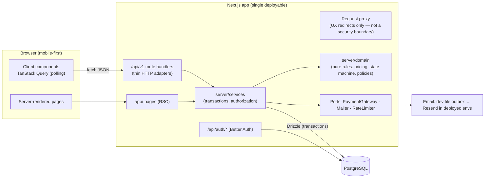
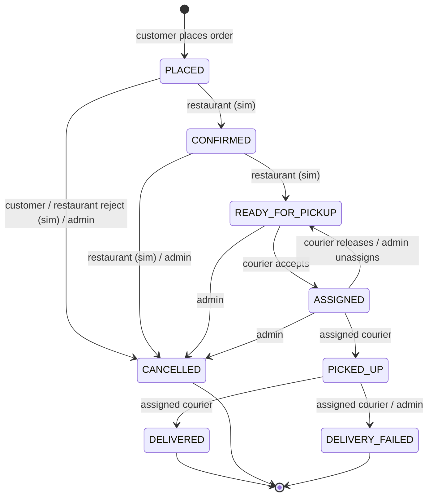

# CoogCrave — Architecture

> **Status:** Approved at Phase 1; revised in Phases 2 and 3 to match the implementation · **Last updated:** 2026-10-11
> Sections marked *(planned)* describe later phases. Everything else reflects code in the repository. Decision changes are logged in §16.

---

## 1. Starting point (Phase 1 inspection, 2026-10-10)

| Item | Finding | Consequence |
|---|---|---|
| Existing code | None — empty workspace, no Git history, no project docs | Greenfield; no stack to preserve |
| GitHub | No account linked to this workspace | Repo is local for now; remote is created when the team provides one |
| Node / pnpm | Node 22.22.0, pnpm 10.28.0 | Node 22 LTS is the baseline |
| PostgreSQL | 16.15 server binaries installed | Integration tests can run against a real local Postgres |
| Docker | CLI present, **no daemon** in this sandbox | `docker-compose.yml` is provided for teammates' machines; this environment and CI use native Postgres / a CI service container |
| Egress policy (found in Phase 2) | This build sandbox blocks `binaries.prisma.sh`, `cdn.playwright.dev`, and Google Fonts | Drove the Drizzle and self-hosted-font decisions; E2E tests run in CI, not in this sandbox (§16) |

---

## 2. Technology decisions

Every row answers *why* and *what we give up*. Versions are checked against the npm registry on 2026-10-10 and will be pinned **exactly** in `package.json` in Phase 2.

| Concern | Choice (version) | Why | Tradeoff accepted |
|---|---|---|---|
| Framework | **Next.js 16.4 (App Router) + React 19**, one deployable | One language end-to-end, shared Zod schemas between client and server, one deploy target. A hackathon team moves fastest with one repo and one runtime. | Backend is coupled to Next's runtime; mitigated by keeping business logic in framework-free modules (§4). |
| Language | **TypeScript 6.0.3**, `strict: true` | Type safety across UI, API, and DB layer. | TS 7.0 is out, but `typescript-eslint` 8.71 supports TypeScript `< 6.1.0`; we stay on 6.0.x until linting supports 7. |
| API style | **Versioned REST route handlers** under `/api/v1` | Documented, testable contracts (the prompt requires method/URL specs); reusable by a future mobile app. | More boilerplate than Server Actions; we do not use Server Actions for mutations. |
| Database | **PostgreSQL 16** | Relational integrity, transactions, partial unique indexes and check constraints — all used for correctness (§7). | Requires a hosted Postgres for deployment. |
| ORM / migrations | **Drizzle ORM 0.45.4 + drizzle-kit 0.31.11** on `pg` 8.23 (changed from Prisma in Phase 2, see §16) | Schema in TypeScript that expresses our partial unique indexes and CHECK constraints natively; generates plain, reviewable SQL migrations; pure npm packages with no engine binaries; SQL-shaped query builder suits compare-and-set updates. | Pre-1.0 (pinned exactly). No down-migrations (rollback = new forward migration). |
| Auth | **Better Auth 1.7.7** (email + password, email verification, password reset, DB sessions) with its Drizzle adapter; rate limiting is ours (§8) | Covers every AUTH requirement without hand-rolling crypto; sessions are server-side rows we can revoke. | Needs four tables (`users`, `sessions`, `accounts`, `verifications`), defined in our schema. Auth.js was rejected: v5 is still a beta tag on npm and its credentials flow lacks built-in verification/reset. |
| Rendering model | **Cache Components off**; every page rendered per request (`await connection()` in the root layout) | Required by the nonce-based CSP (§8, THREAT_MODEL T-21). Next.js documents nonce CSP as incompatible with the prerendered static shell. Almost every page depends on the signed-in user anyway. | No static shells or partial prefetching. Revisit before a Next.js major where Cache Components can't be disabled. |
| Fonts | **Archivo** (variable width, display) and **Atkinson Hyperlegible Next** (body), self-hosted from pinned `@fontsource-variable` packages via `next/font/local` | No third-party requests (keeps CSP `font-src 'self'`, better privacy); builds work without internet access. Atkinson was designed for legibility. | Font files come from `node_modules` at build time. |
| Validation | **Zod 4** | Runtime validation at every trust boundary; the same schema types the client form and the server handler. | — |
| Styling / UI | **Tailwind CSS 4.3** with design tokens in `@theme`; **shadcn/ui** components (source copied into repo, Radix primitives); `lucide-react` icons; `sonner` toasts | Accessible primitives (focus management, ARIA) without a heavy component dependency; tokens keep colors in one place. | We own the copied component code. |
| Client data | **TanStack Query 5** | Polling with automatic pause when the tab is hidden, retries, mutation loading/error states across ~25 screens. | One more dependency; justified by the amount of async UI state. |
| Forms | `react-hook-form` + Zod resolver | Accessible forms with field-level errors from the shared schemas. | — |
| Logging | **pino 10** with redaction | Structured JSON logs; redaction paths keep secrets/PII out of logs. | — |
| Tests | **Vitest 5** (unit + integration against real Postgres), **React Testing Library**, **Playwright 1.64** (E2E) | Fast unit tests; real-DB integration tests catch constraint and concurrency bugs that mocks hide. | Integration tests need a Postgres instance locally and in CI. |
| Quality | **ESLint 10.12** + typescript-eslint 8.71 (type-aware rules), full jsx-a11y recommended set, Prettier 3.9 with the Tailwind plugin | Lint enforces layering, accessibility, and security rules (§4, THREAT_MODEL T-21/T-22). ESLint 9 is end-of-life upstream. | Three Next.js lint plugins still declare ESLint ≤ 9 peers; they were verified working on 10 and the peer ranges are overridden in `pnpm-workspace.yaml` with a removal note. |
| Package manager | **pnpm 10** with committed lockfile; `--frozen-lockfile` in CI | Reproducible installs, strict dependency resolution. | Teammates need pnpm (`corepack enable`). |
| CI | **GitHub Actions** | Prompt requirement; free for public repos. | — |
| Hosting (proposed) | **Vercel** (app) + **Neon** (Postgres), email via **Resend** | Zero-ops, free tiers, preview deployments. | Needs accounts/credentials — Phase 8 blocker until provided (Q5). |

### Alternatives considered

- **Spring Boot API + Next.js frontend.** A strong choice for a Java-heavy team and closer to a typical enterprise backend. Not the default because it means two deployables, two languages, and duplicated validation rules. If the team is much faster in Java, this is the one decision worth revisiting before Phase 2 — the domain model, API spec, and state machine in these docs carry over unchanged.
- **Prisma 7.10 (the Phase 1 choice).** Mature tooling, but every CLI command, including `prisma generate`, downloads a native engine from `binaries.prisma.sh`, which the build sandbox blocks, so no database code could be generated or verified there. It also needs hand-written SQL for our partial indexes and CHECK constraints. Replaced by Drizzle with approval (§16).
- **WebSockets / SSE instead of polling.** Real-time push needs either a stateful server or a third-party service. Polling every ~5 s is accurate enough for food delivery and works on serverless with zero extra infrastructure. The tracking endpoint is designed so SSE can be added later without changing the data model.
- **Supabase (auth + DB bundle).** Fine, but couples auth to the DB vendor; Better Auth keeps both portable.

---

## 3. System overview



**Two entry points, one rulebook.** Server-rendered pages read through services directly; client mutations go through `/api/v1`. Both pass an `Actor` into the service layer, and **authorization is enforced inside services**, so neither entry point can bypass it.

---

## 4. Layering and folder structure

```
coogcrave/
├─ db/
│  └─ migrations/              # SQL generated by drizzle-kit (plus hand-written grant migrations), committed and reviewed
├─ drizzle.config.ts           # drizzle-kit: schema location, output folder, migrator connection
├─ scripts/                    # local Postgres, role bootstrap SQL, CI checks, and CLIs: seed.ts, seed-demo.ts, admin-create.ts
├─ src/
│  ├─ proxy.ts                 # per-request CSP nonce + signed-out UX redirect (not an auth boundary)
│  ├─ app/                     # routes only: layout, pages, error states
│  │  ├─ sign-up/ sign-in/ check-email/ forgot-password/ reset-password/   # account pages (Phase 3)
│  │  ├─ profile/              # signed-in account page (Phase 3)
│  │  ├─ admin/                # activity log (Phase 3); users, couriers, restaurants, menus, orders, kitchen later
│  │  ├─ (planned) restaurants/, cart/, checkout/, orders/, courier/
│  │  └─ api/
│  │     ├─ auth/[...all]/route.ts   # Better Auth handler
│  │     ├─ health/route.ts
│  │     └─ v1/**/route.ts           # thin adapters → services
│  ├─ components/
│  │  ├─ ui/                   # primitives: Button, fields (text, password, select), Notice
│  │  ├─ layout/               # site header
│  │  └─ features/             # composed, feature-specific components (auth, profile, landing)
│  ├─ client/                  # API client, query keys, hooks (browser-only code)
│  ├─ shared/                  # Zod schemas, DTO types, enums — safe for client and server
│  └─ server/                  # never imported by client code (enforced with `server-only`)
│     ├─ config.ts             # env parsed with Zod; app fails fast on bad config
│     ├─ db/client.ts          # pg pool + Drizzle instance (app role); db/schema/ holds table definitions
│     ├─ security/headers.ts   # CSP builder, static security headers, nonce generation
│     ├─ health.ts             # /api/health logic with injectable dependencies
│     ├─ auth/                 # Better Auth config, /api/auth wrapper, session → Actor, page guards, password policy, auth rate limits
│     ├─ http/                 # route wrapper: CSRF origin check, rate limits, access level, validation, size limit, errors, logging
│     ├─ domain/               # PURE: access policies, email-domain rule, safe redirects (+ pricing, order state machine, hours later) — no I/O
│     ├─ services/             # use cases: profile, locations, audit (+ cart, checkout, orders, delivery, courier, admin, notifications, demo later)
│     ├─ accounts/             # direct account creation for seeds and the admin CLI (not reachable from HTTP)
│     ├─ seed/                 # catalog + demo-account seed logic (scripts/ are thin wrappers)
│     ├─ payments/             # (planned) PaymentGateway port + DemoPaymentGateway
│     ├─ mail/                 # Mailer port + FileOutboxMailer (dev/test); a real provider is a Phase 8 decision
│     ├─ rate-limit/           # RateLimiter port + Postgres implementation
│     └─ logger.ts
├─ tests/
│  ├─ unit/                    # pure logic and HTTP pipeline (dependencies injected)
│  ├─ component/               # React Testing Library in jsdom
│  ├─ integration/             # services + route handlers against real Postgres (app role)
│  ├─ e2e/                     # Playwright journeys
│  └─ support/                 # env setup, DB helpers, server-only stub
└─ docs/
```

**Dependency rules** (enforced by ESLint `no-restricted-imports`, checked in CI):

1. `server/domain` imports nothing from Drizzle, `pg`, Next.js, React, or other `server/*` folders. Pure functions in, values out → trivially unit-testable.
2. `server/services` may use `domain`, `db`, and ports. They own transaction boundaries and authorization.
3. `app/api/v1/**` route handlers only parse the request, call one service, and map the result. No business rules.
4. `app/**` never imports `server/db`, Drizzle, or `pg`; `components/**`, `client/**`, and `shared/**` never import anything from `server/`.
5. `shared/` contains no server secrets and no I/O.

Each rule was verified by planting a violation and confirming ESLint reports it (Phase 2 review).

> **In plain terms:** the domain layer is the recipe book, services are the kitchen that follows recipes and touches the pantry (DB), and route handlers are the front counter that takes orders and hands back food. The counter never improvises recipes.

We deliberately do **not** add a repository layer over Drizzle. Its query builder already isolates SQL, and an extra abstraction would add files without adding testability (services are tested against a real DB).

---

## 5. Request lifecycle (`/api/v1`)

Every route handler is wrapped by `withRoute(options, handler)` (`src/server/http/with-route.ts`). Every route must declare its access level (`auth: "public" | "user" | "courier" | "admin"`); there is no default, so forgetting it is a type error. All steps are implemented and tested.

1. Assign `requestId`: reuse the caller's `x-request-id` only if it matches `[A-Za-z0-9_-]{8,64}` (safe to echo into logs and headers), otherwise generate one. Attach it to a child logger and the response header.
2. For mutations (`POST/PUT/PATCH/DELETE`), CSRF defense in depth: reject if `Origin` is present and isn't the app origin, or if `Sec-Fetch-Site` is present and isn't `same-origin`/`none`. Requests with neither header come from non-browser clients, which can't ride a victim's cookies.
3. Per-IP rate limits: the default 300/min plus any the route adds, checked **before** the session lookup so floods are turned away cheaply. `/api/health` opts out (`rateLimits: false`).
4. Resolve session → `Actor` (`userId`, `role`, `emailVerified`, `suspended`, `courier: { status, isOnline } | null`), reading the user row on every request so role changes and suspension apply immediately. Enforce the access level with the pure `checkAccess` policy, which reports the most basic problem first: `401 UNAUTHENTICATED` → `403 ACCOUNT_SUSPENDED` → `403 EMAIL_NOT_VERIFIED` → `403 COURIER_NOT_APPROVED` / `FORBIDDEN`. The handler receives an `actor` whose type matches the level (never null on protected routes).
5. Per-user rate limits (e.g. `PATCH /me` 30/min), keyed by user ID.
6. Validate path params (a malformed ID is `404`, so probing learns nothing) and query parameters (`400`).
7. If the route declares a body schema: require `application/json` (`415`), enforce the size limit (default 16 KB, `413`) on the declared length **and** on the bytes actually streamed, parse JSON, and validate with a strict Zod object (unknown fields rejected, which blocks mass assignment).
8. Call the handler with `{ request, actor, params, query, body, requestId, log }`.
9. Map `AppError` codes to HTTP through one table (`ERROR_STATUS`) and the standard error envelope (`API_SPEC.md` §1); `429` carries `Retry-After`. A stray `ZodError` maps to `400`.
10. Log one structured line: method, path, status, duration, requestId, userId (when signed in), never bodies or query strings.

`/api/auth/*` is served by Better Auth behind a sibling wrapper (`src/server/auth/route-handler.ts`) that shares the same guards (`src/server/http/request-guards.ts`): request ID, same-origin check on every POST, JSON only, 16 KB limit, auth-specific rate limits, and logging with reset tokens removed from paths.

Unexpected exceptions return `500 INTERNAL_ERROR` with only the `requestId`; the error and stack go to logs. Responses default to `cache-control: no-store`.

---

## 6. Order state machine

The delivery workflow is an explicit state machine defined as **data** in `server/domain/order-state-machine.ts`. Every status change in the system — customer cancel, simulated restaurant action, courier accept, admin override — goes through one service function, `transitionOrder()`, so locking, history, notifications, and authorization are implemented once.

> **In plain terms:** it's a board game. Each square is a status, the rulebook lists which moves are legal and who may make them, and there's a single referee (`transitionOrder`) — no side doors.



### Transition table

Actor types: `CUSTOMER` (order owner), `COURIER` (eligible / assigned courier), `RESTAURANT_SIM` (admin in Kitchen Console, or demo auto-advance), `ADMIN`.

| # | From → To | Allowed actors | Guards | Side effects (same transaction) |
|---|---|---|---|---|
| T1 | PLACED → CONFIRMED | RESTAURANT_SIM | — | event; notify customer |
| T2 | PLACED → CANCELLED | CUSTOMER, RESTAURANT_SIM, ADMIN | reason required for RESTAURANT_SIM / ADMIN | event; void simulated payment; notify customer; audit if admin |
| T3 | CONFIRMED → READY_FOR_PICKUP | RESTAURANT_SIM | — | event; order becomes an offer; notify customer |
| T4 | CONFIRMED → CANCELLED | RESTAURANT_SIM, ADMIN | reason required | event; void payment; notify; audit if admin |
| T5 | READY_FOR_PICKUP → ASSIGNED | COURIER | courier eligibility (`PRODUCT_REQUIREMENTS.md` §6, rule 4); not own order | create active assignment; event; notify customer |
| T6 | READY_FOR_PICKUP → CANCELLED | ADMIN | reason required | event; void payment; notify; audit |
| T7 | ASSIGNED → READY_FOR_PICKUP | assigned COURIER, ADMIN | reason required | release assignment; event; notify customer; audit if admin |
| T8 | ASSIGNED → PICKED_UP | assigned COURIER | — | event; notify customer |
| T9 | ASSIGNED → CANCELLED | ADMIN | reason required | release assignment; event; void payment; notify both; audit |
| T10 | PICKED_UP → DELIVERED | assigned COURIER | — | complete assignment + fix simulated payout; capture simulated payment; event; notify; enable review |
| T11 | PICKED_UP → DELIVERY_FAILED | assigned COURIER, ADMIN | reason required | complete assignment (no payout); void payment; event; notify; audit if admin |

Anything not in the table is rejected with `409 INVALID_TRANSITION`. Terminal states (`DELIVERED`, `CANCELLED`, `DELIVERY_FAILED`) have no outgoing transitions. `canTransition(order, toStatus, actor)` is a pure function with exhaustive unit tests (every from × to × actor combination).

**Why assignment happens at `READY_FOR_PICKUP`** (not at `CONFIRMED` like commercial apps): it keeps a single linear status and matches the specified flow. Cost: food may wait for a courier. Future improvement: dispatch during preparation by modelling assignment as a separate dimension.

---

## 7. Concurrency and idempotency

### 7.1 Two couriers accept the same order at the same moment

`acceptOffer` runs in one transaction at `READ COMMITTED`:

1. **Compare-and-set on status:**
   `UPDATE orders SET status = 'ASSIGNED', status_updated_at = now(), version = version + 1 WHERE id = $order AND status = 'READY_FOR_PICKUP' AND customer_id <> $courier`
   The first transaction takes the row lock. The second blocks on that lock; when the first commits, Postgres re-checks the `WHERE` clause against the new row, sees `ASSIGNED`, and updates **0 rows** → the service returns `409 OFFER_UNAVAILABLE`.
2. **Insert the assignment.** A partial unique index allows only one *active* assignment per order (backstop for any code path that forgets step 1), and another allows only one *active* assignment per courier (enforces "one delivery at a time" even if a courier double-taps two offers). A unique violation rolls back the transaction → `409 COURIER_HAS_ACTIVE_DELIVERY`.
3. Insert status event + notification, commit.

> **In plain terms:** it's the last ticket at a box office. Many people can reach for it, but the clerk (the row lock) serves one at a time and checks "still available?" for each. The loser gets "sold out," never a duplicate ticket — and the database itself, not our app code, is the final judge.

Verified by an integration test that fires N concurrent accepts from N couriers and asserts exactly one `200`, N−1 `409`s, and exactly one active assignment row.

The same compare-and-set pattern (`WHERE status = <expected from-status>`) is used for **every** transition, so a courier marking "picked up" while an admin cancels can't both succeed. A stale update returns `409 STALE_STATE` and the client refetches.

### 7.2 Placing an order twice (double click, flaky network)

`POST /api/v1/orders` requires an `Idempotency-Key` header (UUID generated by the client once per checkout attempt). The key and a SHA-256 hash of the request body are stored on the order with a unique constraint on `(customer_id, idempotency_key)`:

- Key not seen → validate cart, price, create order (single transaction).
- Key seen, same body hash → return the existing order with `Idempotent-Replayed: true` (no second order).
- Key seen, different body → `422 IDEMPOTENCY_KEY_REUSED`.
- Two identical requests racing → the second blocks on the unique index, then fails and replays the first result.

Courier accept is naturally idempotent: if the same courier already holds that order, the existing assignment is returned with `200`.

### 7.3 Prices changing during checkout

The client sends the `expectedTotalCents` it displayed. The server always computes its own total; if they differ, it returns `409 PRICE_CHANGED` with a fresh quote and **does not** place the order. The client's number is a consistency check, never an input to pricing.

---

## 8. Authentication and authorization

Implemented in Phase 3 (`src/server/auth/`). Endpoint-level behavior is in `API_SPEC.md` §3.

- **Better Auth 1.7.7** handles registration, sign-in, sessions, email verification, and password reset at `/api/auth/*`, storing everything in our Postgres tables through the Drizzle adapter. Endpoints we don't use (account deletion, email change, session listing, social sign-in, …) are switched off with `disabledPaths` and return `404`; profile edits go through `PATCH /api/v1/me` so they follow our validation.
- `requireEmailVerification: true`: unverified accounts can't sign in, and trying (with the right password) re-sends the link. Verifying doesn't sign the user in, so a mail scanner that "clicks" the link gets nothing. Our access policy also checks `emailVerified` as defense in depth.
- **Sign-up rules**, enforced in a Better Auth `before` hook so they apply no matter which client calls the endpoint: email domain in `ALLOWED_EMAIL_DOMAINS` (exact domain or a subdomain, so `cougarnet.uh.edu` works and `uh.edu.attacker.example` doesn't); name 1–100 characters without markup; password policy below.
- **Password policy** (`password-policy.ts`): 10–128 characters, a zxcvbn-ts strength score of at least 3 out of 4, and not built from the user's own name or email words (`alex-rivera-2026` is refused). Think of it as a bouncer who judges how guessable a password is rather than checking that it has a symbol in it: `Spring2027!` ticks every composition box and is still refused, while a few unrelated words pass. The browser form checks only length; the server's message (with zxcvbn's hint) is shown on the password field.
- **Account enumeration:** sign-up answers the same for new and existing emails (the existing owner gets a notice email instead); sign-in answers the same for unknown emails and wrong passwords; reset requests always say "if an account exists…".
- Custom user fields `role` (`STUDENT | ADMIN`) and `suspendedAt` are declared with `input: false`, so **sign-up requests cannot set them** (tested with `role: "ADMIN"`). Suspended users can't start a session (a session-create hook refuses), and every request re-reads the flag.
- **Sessions:** database-backed; cookie `coogcrave.session_token`, httpOnly, `SameSite=Lax`, `Secure` whenever `APP_URL` is https. **Fixed 7-day lifetime, no sliding refresh:** our pages read sessions in Server Components, which can't re-issue cookies, so a sliding refresh would extend the database row while the browser cookie still expired on day 7. Cookie caching is off, so sign-out and suspension take effect on the next request. Password reset signs out every session. (Deleting sessions on suspension arrives with the suspend endpoint, Phase 6.)
- **Origin checks pinned on:** Better Auth disables its origin and CSRF checks when `NODE_ENV=test`. We set `disableOriginCheck: false` and `disableCSRFCheck: false` explicitly so tests exercise production behavior; this caught real open-redirect test failures.
- **Rate limits** use our Postgres limiter rather than Better Auth's (ours adds per-email limits and is shared across instances). Values in `API_SPEC.md` §1.
- **Page protection** (`page-guards.ts`): `requirePageAccess(level, path)` runs the same `checkAccess` policy. Signed-out or unverified visitors are redirected to `/sign-in?next=…` (sanitized by `safeNextPath`); suspended users to `/sign-in?suspended=1`; signed-in users without the capability get a real `404` for admin and courier pages, so those areas aren't advertised. `getCurrentActor()` is wrapped in React `cache()` so the header and the page share one session lookup per request.
- **Authorization lives in services**, expressed as pure policy functions in `server/domain/policies.ts` (`canViewOrder`, `canAcceptOffer`, `canReview`, …). Route-level auth levels are a first filter only.
- The Next.js request proxy (formerly "middleware") only redirects visitors with **no session cookie at all** away from `/profile`, `/admin`, and `/courier`, to save a render. It doesn't validate the cookie and is never the security boundary — a 2025 Next.js vulnerability (CVE-2025-29927) allowed middleware to be skipped entirely, which is exactly why real checks belong in the service layer.
- Resource access returns **404** (not 403) when a user asks for an order they aren't allowed to see, so IDs can't be probed.
- Admin accounts are created only by the demo seed or `pnpm admin:create` (CLI with direct DB access; the password comes from `ADMIN_PASSWORD` or a hidden prompt, and each run writes a `SYSTEM` audit event). No API grants admin.

---

## 9. External boundaries (ports)

Each external dependency sits behind a small interface so the hackathon simulation can be swapped for a real provider without touching services.

| Port | MVP implementation | Real implementation later | Labeled in UI? |
|---|---|---|---|
| `PaymentGateway` (`authorize`, `capture`, `void`) | `DemoPaymentGateway` — records `payments` rows with provider `DEMO`, moves no money | Stripe (PaymentIntents with manual capture maps 1:1 to authorize/capture/void) | Yes: "Demo checkout — no real payment is taken" |
| `Mailer` (`send`) — implemented | `FileOutboxMailer` writes each email as a JSON file (mode 0600, written atomically) to `MAIL_OUTBOX_DIR` (default `.data/mail`) in development/test; tests and the E2E suite read verification and reset links from it | A real provider (e.g. Resend), chosen in Phase 8. Deployed environments refuse to start with the file transport | N/A — real flow, local transport. The check-email page tells local users where the outbox is |
| `RateLimiter` (`consume(rule, subject)`) — implemented | `PostgresRateLimiter`: fixed windows in `rate_limit_buckets`, one atomic upsert per check, subjects hashed | Redis/Upstash if traffic requires | — |
| Restaurant fulfillment | Kitchen Console (admin, `RESTAURANT_SIM`) + optional demo auto-advance (non-production only) | Merchant portal / POS integration | Yes: "Simulated restaurant action" |

Why the rate limiter is in Postgres and not in memory: serverless instances don't share memory, so an in-process counter would let a client exceed limits by hitting different instances.

---

## 10. Notifications

Notifications are rows written **inside the same transaction** as the status change that caused them, so a notification can never exist for a change that rolled back (and vice versa). Clients poll `GET /api/v1/notifications` (unread count in the header bar). Push/email delivery can later be added by a worker that reads new rows — the write side doesn't change.

---

## 11. Frontend architecture

- **Rendering:** pages are Server Components that load initial data via services (fast first paint, no client waterfall). Interactive islands are Client Components using TanStack Query against `/api/v1`.
- **Polling:** order tracking refetches every 5 s while non-terminal; courier offers every 10 s while online. Both pause when the tab is hidden and stop at terminal states.
- **Design tokens** in `src/app/globals.css` via Tailwind 4 `@theme`. The default Tailwind palette is removed (`--color-*: initial`), so only named tokens exist: brand `crave` red (`#c41e3a`, 5.8:1 on white), `asphalt` text (15.1:1), `concrete` surfaces, and status colors, each pairing checked at ≥ 4.5:1. Semantic aliases (`ink`, `ink-muted`, `surface`, `line`, `action`) are what components use. Brand red and danger red are close in hue, so errors always carry an icon and text, never color alone. A lint rule rejects raw hex values in class names.
- **Type:** Archivo's width axis is part of the identity (wide for headlines, narrow for the second tagline line); Atkinson Hyperlegible Next for body text.
- **No UH logos, mascots, or wordmarks.** "UH-inspired" means palette and tone only.
- **States:** every data view ships loading, empty, and error states. Route-level `error.tsx` and `not-found.tsx` exist. **There is no root `loading.tsx`:** it makes Next.js stream every page, which sends `200` before a guard can answer `307` (redirect) or `404`. Loading states are added per section, inside pages, where they don't affect the status code.
- **Forms:** react-hook-form with the shared Zod schemas, so the browser and the server apply the same rules; server errors are mapped back onto fields. Field primitives wire labels, hints, and errors with `aria-describedby`/`aria-invalid`, and move focus to the first invalid field.
- **Motion:** short transitions for feedback; all animation wrapped in `motion-safe:` / disabled under `prefers-reduced-motion`.
- **PWA-ready:** web manifest and icons in Phase 7; offline support is out of scope.

---

## 12. Configuration and environments

`APP_ENV` ∈ `development | test | preview | production`. `src/server/config.ts` validates variables with Zod on first use (lazily, so `next build` doesn't need runtime secrets) and lists every missing or malformed variable **by name only**, never by value.

| Variable | Purpose | Since |
|---|---|---|
| `APP_ENV` | Environment name; gates HSTS and demo tooling | Phase 2 |
| `APP_URL` | Public origin; used by the CSRF origin check and CSP `upgrade-insecure-requests`. Must be https when deployed | Phase 2 |
| `DATABASE_URL` | Runtime connection as the app role (pooled in hosted envs) | Phase 2 |
| `MIGRATOR_DATABASE_URL` | Migrations as the migrator role (read by `drizzle.config.ts`, not by the app) | Phase 2 |
| `TEST_DATABASE_URL`, `TEST_MIGRATOR_DATABASE_URL` | Integration tests; database name must end in `_test` | Phase 2 |
| `DB_POOL_MAX`, `LOG_LEVEL`, `GIT_SHA` | Pool size (default 10), pino level, build version reported by `/api/health` | Phase 2 |
| `BETTER_AUTH_SECRET` | Signs session cookies and verification tokens; at least 32 characters. Deployed environments refuse the documented local placeholder | Phase 3 |
| `ALLOWED_EMAIL_DOMAINS` | Comma-separated sign-up allowlist (default `uh.edu`, which also admits its subdomains) | Phase 3 |
| `MAIL_TRANSPORT` (`file`), `MAIL_FROM`, `MAIL_OUTBOX_DIR` | Email delivery. Only `file` exists; deployed environments refuse it, so a real provider must be added before deployment (Phase 8) | Phase 3 |
| `SEED_DEMO_PASSWORD` | Password for seeded demo accounts (10+ characters; never in source code; demo seed refuses to run in production) | Phase 3 |
| `ADMIN_PASSWORD` | Optional, read only by `pnpm admin:create`; without it the CLI prompts with hidden input | Phase 3 |
| `DEMO_RESET_ENABLED`, `DEMO_AUTO_ADVANCE` | Demo tooling; both ignored when `APP_ENV=production` | Phase 6 |

`.env.example` documents the variables in use, with local-only placeholder values. `APP_ENV` is also read at **build** time (HSTS headers are baked into the build), so deployments must set it for the build step too.

**Least-privilege database roles** (`scripts/sql/bootstrap-roles.sql`, used locally, in Docker, and in CI): `coogcrave_migrator` owns the databases and the `public` schema and runs migrations; `coogcrave_app` gets `SELECT/INSERT/UPDATE/DELETE` on tables the migrator creates (via default privileges) and nothing else. Verified by integration tests: the app role can't create, alter, drop, or truncate tables. Migration `0001` leaves the app role **only `SELECT/INSERT`** on `audit_events` and `order_status_events`, making both append-only at the database level (tested).

---

## 13. Observability

- pino JSON logs with `requestId`, route, status, duration, and `userId` when signed in. Better Auth's own log messages are routed through pino with email addresses replaced by `[email]`. The keys `password`, `newPassword`, `currentPassword`, `token`, `accessToken`, `refreshToken`, `secret`, `cookie`, `authorization`, `deliveryInstructions`, and `email` are redacted at any depth up to four levels (tested).
- `GET /api/health` checks DB connectivity (used by deployment smoke tests).
- Domain events (status changes, admin actions) are already persisted in `order_status_events` and `audit_events`, which doubles as an audit trail.

---

## 14. Deployment (proposed — Phase 8)

Vercel hosts the Next.js app; Neon hosts Postgres (pooled URL for the app, direct URL for migrations). Migrations run as an explicit pipeline step (`pnpm db:migrate`, i.e. `drizzle-kit migrate` as the migrator role) before the production deploy, never at app boot. Preview deployments per PR use a separate database and `APP_ENV=preview`. Nothing is deployed or purchased without approval; until credentials exist, the supported path is local (`DEPLOYMENT.md`, Phase 8).

---

## 15. Extension points (designed for, not built)

| Future capability | What already makes it cheap |
|---|---|
| Multiple campuses | `campuses` table; restaurants, drop points, and fees belong to a campus |
| Real payments | `PaymentGateway` port with authorize/capture/void semantics; `payments` table keyed by provider |
| Merchant portal | `RESTAURANT_SIM` actor slot in the transition table → real `RESTAURANT_STAFF` actor |
| Push / email notifications | Notifications already persisted transactionally; add a delivery worker |
| Real-time tracking | Tracking endpoint returns full state; SSE can replace polling without schema changes |
| Dispatch / routing | Offers query is isolated in one service function |
| Native apps | Versioned REST API; auth library supports bearer tokens |

---

## 16. Decision log

| Date | Decision | Why | Approved by |
|---|---|---|---|
| 2026-10-10 | Initial stack (§2) | Phase 1 architecture | Emman (Phase 1 checkpoint) |
| 2026-10-10 | **Prisma → Drizzle** | Every Prisma 7.10 CLI command needs a native engine from `binaries.prisma.sh`, which the build sandbox's egress policy blocks, so no DB code could be generated or tested there. Drizzle installs from npm alone, expresses partial unique indexes and CHECK constraints in the schema, and passed a 10-courier concurrent-accept probe (exactly 1 winner) as the app role before adoption. | Emman (asked mid-Phase 2) |
| 2026-10-10 | **ESLint 10.12** instead of 9 | ESLint 9 is end-of-life upstream; the three Next.js plugins with stale peer ranges were verified to run on 10 (they flagged planted violations). | Claude, recorded for review |
| 2026-10-10 | **Cache Components off**, nonce CSP on | Next.js documents nonce-based CSP as incompatible with Cache Components' prerendered shell; XSS defense in depth was prioritized over static-shell performance for a session-heavy app. | Claude, recorded for review |
| 2026-10-10 | **Self-hosted fonts** | Google Fonts is unreachable from the build sandbox; self-hosting also removes a third-party request and keeps `font-src 'self'`. | Claude, recorded for review |
| 2026-10-10 | `DIRECT_DATABASE_URL` renamed **`MIGRATOR_DATABASE_URL`** | Names the role rather than the connection type. | Claude, recorded for review |
| 2026-10-11 | **UUIDs for auth tables too** (`generateId: "uuid"`) | One ID type everywhere, so every `user_id` column is a real `uuid` foreign key instead of `text`. | Claude, recorded for review |
| 2026-10-11 | **Our Postgres rate limiter instead of Better Auth's** | Better Auth's limiter is per-IP only; ours adds per-email limits (protects one account from a distributed attack and inboxes from flooding) and is shared by every server instance. | Claude, recorded for review |
| 2026-10-11 | **Fixed 7-day sessions** (was: sliding refresh) | Sessions are read in Server Components, which can't set cookies, so sliding refresh would extend the database row but not the browser cookie. A fixed lifetime is honest about when users are signed out. | Claude, recorded for review |
| 2026-10-11 | **zxcvbn-ts password policy** (score ≥ 3, 10–128 chars, no personal words) instead of "≥ 10 chars + common-password list" | Rejects guessable passwords that pass composition rules (`Spring2027!`) and accepts long passphrases without symbol rules, per NIST SP 800-63B guidance. | Claude, recorded for review |
| 2026-10-11 | **Better Auth origin/CSRF checks pinned on** | The library turns them off under `NODE_ENV=test`, which would let tests pass against weaker behavior than production. | Claude, recorded for review |
| 2026-10-11 | **Root `loading.tsx` removed** | It forced streaming, so protected pages answered `200` before guards could redirect (`307`) or hide (`404`). Found by the E2E suite. | Claude, recorded for review |
| 2026-10-11 | **Fictional restaurant names** in seed data — **changes the D2 default** (real venue names) | The repository is public, and real venue names next to invented menus, prices, and hours could read as affiliation or misinformation; the plan's own risk table said to switch to fictional "if any doubt". Buildings stay real so drop-offs are recognizable. Reverting is a seed-data change only. | **Needs Emman's decision at the Phase 3 checkpoint** |
| 2026-10-11 | **Scripts run with `tsx --conditions=react-server`** | Lets CLIs import server modules guarded by `server-only` without weakening that guard for client bundles. | Claude, recorded for review |
| 2026-10-11 | **Mail: file transport only** for now (no Resend code yet) | No provider account exists; shipping an untested provider adapter would be a placeholder. Deployed config refuses the file transport, so this can't slip into production. | Claude, recorded for review |
