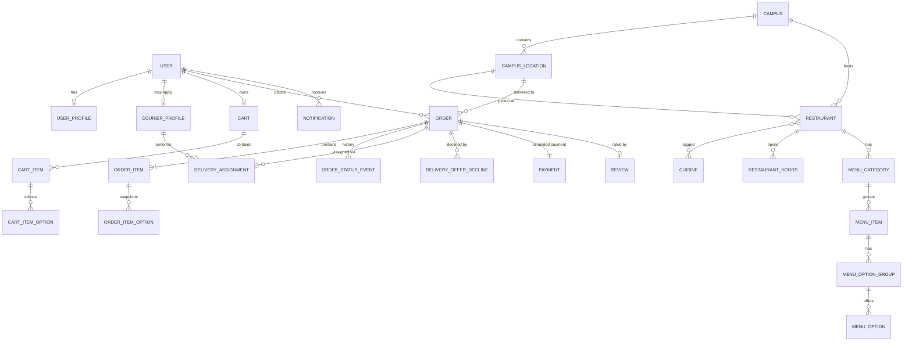

# CoogCrave — Database Design

> **Status:** Draft for Phase 1 architecture checkpoint · **Last updated:** 2026-10-10
> PostgreSQL 16 · Prisma 7.10 · This is the target schema; Phase 3 implements it and this file is updated to match the committed migrations.

---

## 1. Conventions

| Topic | Rule | Why |
|---|---|---|
| Primary keys | `uuid` with DB default `gen_random_uuid()` for application tables; Better Auth tables use the library's string IDs | Non-sequential IDs can't be enumerated by guessing `/orders/1235` |
| Money | **Integer cents** (`integer`), currency fixed to `USD` on orders | Floating point can't represent $0.10 exactly; rounding errors in totals are unacceptable. Like a cashier counting pennies in a drawer instead of estimating fractions of a dollar. |
| Rates | Basis points (`integer`, 825 = 8.25%) | Keeps rate math in integers; rounding rule is explicit (round half up, once, at the line it applies to) |
| Time | `timestamptz`; `created_at` defaults to `now()` in the DB; `updated_at` set server-side by Prisma | Clients never supply timestamps |
| Names | `snake_case` tables/columns (Prisma `@@map` / `@map`), `PascalCase` Prisma models | Idiomatic SQL, idiomatic TS |
| Soft delete | `deleted_at timestamptz NULL` on catalog data (restaurants, menu categories/items/options, campus locations) | Orders keep valid foreign keys to items that were "removed" from the menu |
| Not soft-deleted | Orders, events, payments, reviews, audit events are never deleted; users are **suspended**, not deleted | History and accountability |
| Constraints in SQL | Partial unique indexes and `CHECK` constraints Prisma can't express are written as raw SQL inside the Prisma migration | The DB enforces invariants even if application code has a bug |

---

## 2. Entity overview

---

## 3. Enumerations

| Enum | Values |
|---|---|
| `user_role` | `STUDENT`, `ADMIN` |
| `courier_status` | `PENDING`, `APPROVED`, `REJECTED`, `SUSPENDED` |
| `transport_mode` | `WALK`, `BIKE`, `SCOOTER` |
| `order_status` | `PLACED`, `CONFIRMED`, `READY_FOR_PICKUP`, `ASSIGNED`, `PICKED_UP`, `DELIVERED`, `CANCELLED`, `DELIVERY_FAILED` |
| `actor_type` | `CUSTOMER`, `COURIER`, `RESTAURANT_SIM`, `ADMIN`, `SYSTEM` |
| `assignment_end_reason` | `DELIVERED`, `RELEASED_BY_COURIER`, `UNASSIGNED_BY_ADMIN`, `ORDER_CANCELLED`, `DELIVERY_FAILED` |
| `payment_provider` | `DEMO` |
| `payment_status` | `AUTHORIZED`, `CAPTURED`, `VOIDED` |
| `notification_type` | `ORDER_PLACED`, `ORDER_CONFIRMED`, `ORDER_READY`, `COURIER_ASSIGNED`, `COURIER_RELEASED`, `ORDER_PICKED_UP`, `ORDER_DELIVERED`, `ORDER_CANCELLED`, `DELIVERY_FAILED`, `COURIER_APPLICATION_DECIDED` |

---

## 4. Tables

Abbreviations: **PK** primary key · **FK** foreign key · **U** unique · **NN** not null · **IDX** index.

### 4.1 Identity (Better Auth managed)

Better Auth owns `user`, `session`, `account` (holds the password hash for email/password sign-in), and `verification` (email-verification and reset tokens). Exact columns come from the pinned Better Auth version via its schema generator. We add two fields to `user`, both declared `input: false` so no client request can set them:

| Column | Type | Notes |
|---|---|---|
| `role` | `user_role` NN default `STUDENT` | Only seed/CLI can create `ADMIN` |
| `suspended_at` | `timestamptz` NULL | Set by admin; sessions deleted on suspend |

### 4.2 `campuses`
Configuration per campus. One row (UH main campus) in the MVP; exists so multi-campus is a data change, not a migration.

| Column | Type | Constraints / notes |
|---|---|---|
| `id` | uuid | PK |
| `slug` | text | U NN (`uh-main`) |
| `name` | text | NN |
| `timezone` | text | NN (`America/Chicago`) |
| `delivery_fee_cents` | integer | NN, `CHECK ≥ 0` (sample 249) |
| `service_fee_bps` | integer | NN, `CHECK 0–10000` |
| `service_fee_min_cents`, `service_fee_max_cents` | integer | NN, `CHECK min ≤ max` |
| `tax_rate_bps` | integer | NN — **sample rate, labeled in UI** |
| `min_subtotal_cents` | integer | NN (sample 500) |
| `max_tip_cents` | integer | NN (sample 5000) |
| `created_at`, `updated_at` | timestamptz | |

### 4.3 `user_profiles`
App-level profile kept separate from auth tables so changing auth providers never touches app data.

| Column | Type | Constraints / notes |
|---|---|---|
| `user_id` | text | PK, FK → `user.id` ON DELETE CASCADE |
| `display_name` | text | NULL, ≤ 60 chars |
| `default_location_id` | uuid | FK → `campus_locations.id`, NULL |
| `created_at`, `updated_at` | timestamptz | |

### 4.4 `courier_profiles`

| Column | Type | Constraints / notes |
|---|---|---|
| `id` | uuid | PK |
| `user_id` | text | **U** NN, FK → `user.id` |
| `status` | courier_status | NN default `PENDING` |
| `transport_mode` | transport_mode | NN |
| `guidelines_accepted_at` | timestamptz | NN |
| `is_online` | boolean | NN default false; **`CHECK (NOT is_online OR status = 'APPROVED')`** |
| `online_since` | timestamptz | NULL |
| `applied_at` | timestamptz | NN default now() |
| `reviewed_at` | timestamptz | NULL |
| `reviewed_by_user_id` | text | FK → `user.id`, NULL |
| `review_note` | text | NULL, ≤ 500 |
| `created_at`, `updated_at` | timestamptz | |

IDX: `(status)` for the admin approval queue; partial `(id) WHERE is_online` for online counts.

### 4.5 `campus_locations`
Implements "delivery locations." Buildings and landmarks on campus; used both as restaurant pickup sites and as customer drop points.

| Column | Type | Constraints / notes |
|---|---|---|
| `id` | uuid | PK |
| `campus_id` | uuid | FK NN |
| `name` | text | NN (e.g., "MD Anderson Library — main entrance") |
| `short_name` | text | NN (shown on courier offers) |
| `description` | text | NULL (landmark hints) |
| `is_drop_point` | boolean | NN default true |
| `sort_order` | integer | NN default 0 |
| `deleted_at` | timestamptz | NULL |

U: `(campus_id, name) WHERE deleted_at IS NULL`.

### 4.6 Catalog

**`restaurants`**

| Column | Type | Constraints / notes |
|---|---|---|
| `id` | uuid | PK |
| `campus_id` | uuid | FK NN |
| `location_id` | uuid | FK → `campus_locations` NN (pickup building) |
| `slug` | text | U NN |
| `name` | text | NN |
| `description` | text | NULL |
| `image_path` | text | NULL (local asset under `/public/images/sample/`) |
| `pickup_notes` | text | NULL |
| `is_accepting_orders` | boolean | NN default true (admin switch) |
| `is_sample_data` | boolean | NN default true (drives the "Sample" badge) |
| `created_at`, `updated_at`, `deleted_at` | timestamptz | |

IDX: `(campus_id) WHERE deleted_at IS NULL`; trigram index on `name` for search (`pg_trgm`) if search needs it — decided in Phase 4 after measuring.

**`cuisines`** — `id`, `slug` U, `name`. **`restaurant_cuisines`** — PK `(restaurant_id, cuisine_id)`.

**`restaurant_hours`**

| Column | Type | Constraints / notes |
|---|---|---|
| `id` | uuid | PK |
| `restaurant_id` | uuid | FK NN |
| `day_of_week` | smallint | `CHECK 0–6` (0 = Sunday, campus time zone) |
| `opens_at_minute` | smallint | `CHECK 0–1439` |
| `closes_at_minute` | smallint | `CHECK opens_at_minute < closes_at_minute ≤ 2880` (values > 1440 mean after midnight) |

U: `(restaurant_id, day_of_week, opens_at_minute)`. Multiple rows per day allow split shifts.

**`menu_categories`** — `id`, `restaurant_id` FK, `name`, `sort_order`, `deleted_at`. U `(id, restaurant_id)` (target of the composite FK below); U `(restaurant_id, name) WHERE deleted_at IS NULL`.

**`menu_items`**

| Column | Type | Constraints / notes |
|---|---|---|
| `id` | uuid | PK |
| `restaurant_id` | uuid | FK NN |
| `category_id` | uuid | NN; **composite FK `(category_id, restaurant_id)` → `menu_categories (id, restaurant_id)`** so an item can't be filed under another restaurant's category |
| `name` | text | NN, ≤ 80 |
| `description` | text | NULL, ≤ 300 |
| `price_cents` | integer | NN `CHECK ≥ 0` |
| `image_path` | text | NULL |
| `is_available` | boolean | NN default true |
| `sort_order` | integer | NN default 0 |
| `created_at`, `updated_at`, `deleted_at` | timestamptz | |

IDX: `(restaurant_id, category_id, sort_order) WHERE deleted_at IS NULL`.

**`menu_option_groups`** — `id`, `menu_item_id` FK, `name` (e.g., "Size"), `min_select` (`CHECK ≥ 0`), `max_select` (`CHECK ≥ 1 AND ≥ min_select`), `sort_order`, `deleted_at`.
A group with `min_select = 1, max_select = 1` is a required single choice; `0..3` is "up to three add-ons."

**`menu_options`** — `id`, `option_group_id` FK, `name`, `price_delta_cents` (`CHECK ≥ 0`), `is_available`, `sort_order`, `deleted_at`.

### 4.7 Cart (server-side)

**`carts`** — `id`, `user_id` **U** FK, `restaurant_id` FK NN, `created_at`, `updated_at`. One cart per user, one restaurant per cart.

**`cart_items`** — `id`, `cart_id` FK ON DELETE CASCADE, `menu_item_id` FK, `quantity` (`CHECK 1–20`), `special_instructions` (≤ 140), `created_at`.

**`cart_item_options`** — PK `(cart_item_id, menu_option_id)`, cascade on cart item delete.

Carts store **no prices**; every read computes current prices, so a menu change is reflected immediately and unavailable items are flagged.

### 4.8 Orders

**`orders`**

| Column | Type | Constraints / notes |
|---|---|---|
| `id` | uuid | PK |
| `order_number` | text | **U** NN — short human-friendly code (e.g., `CC-7K3Q9`), random, retried on collision |
| `customer_id` | text | FK → `user.id` NN |
| `campus_id` | uuid | FK NN |
| `restaurant_id` | uuid | FK NN |
| `restaurant_name_snapshot` | text | NN |
| `delivery_location_id` | uuid | FK → `campus_locations` NN |
| `delivery_location_snapshot` | text | NN (building name at order time) |
| `delivery_instructions` | text | NULL, ≤ 280 — redacted per retention policy |
| `status` | order_status | NN default `PLACED` |
| `status_updated_at` | timestamptz | NN default now() |
| `subtotal_cents`, `delivery_fee_cents`, `service_fee_cents`, `tax_cents`, `tip_cents`, `total_cents` | integer | NN, each `CHECK ≥ 0`; **`CHECK total_cents = subtotal_cents + delivery_fee_cents + service_fee_cents + tax_cents + tip_cents`** |
| `currency` | char(3) | NN default `USD` |
| `idempotency_key` | uuid | NN |
| `request_hash` | char(64) | NN (SHA-256 of canonical request body) |
| `version` | integer | NN default 0 (incremented on every transition) |
| `created_at`, `updated_at` | timestamptz | |

Constraints and indexes:
- **U `(customer_id, idempotency_key)`** — duplicate-submit protection.
- IDX `(customer_id, created_at DESC)` — order history.
- IDX `(status_updated_at) WHERE status = 'READY_FOR_PICKUP'` — courier offers query.
- IDX `(status, created_at DESC)` — admin order list.
- IDX `(restaurant_id, created_at DESC)` — Kitchen Console.

**`order_items`** — snapshot of what was bought.

| Column | Type | Constraints / notes |
|---|---|---|
| `id` | uuid | PK |
| `order_id` | uuid | FK NN |
| `menu_item_id` | uuid | FK NN (soft-deleted items keep the reference valid) |
| `name_snapshot` | text | NN |
| `unit_price_cents` | integer | NN `CHECK ≥ 0` |
| `options_total_cents` | integer | NN `CHECK ≥ 0` |
| `quantity` | integer | NN `CHECK 1–20` |
| `line_total_cents` | integer | NN; **`CHECK line_total_cents = (unit_price_cents + options_total_cents) * quantity`** |
| `special_instructions` | text | NULL, ≤ 140 |

**`order_item_options`** — `id`, `order_item_id` FK, `menu_option_id` FK, `group_name_snapshot`, `option_name_snapshot`, `price_delta_cents` (`CHECK ≥ 0`).

**`order_status_events`** — append-only history; the tracking timeline reads this.

| Column | Type | Constraints / notes |
|---|---|---|
| `id` | uuid | PK |
| `order_id` | uuid | FK NN |
| `from_status` | order_status | NULL (null for the creation event) |
| `to_status` | order_status | NN |
| `actor_type` | actor_type | NN |
| `actor_user_id` | text | FK → `user.id`, NULL (null for SYSTEM / auto-advance) |
| `reason` | text | NULL, ≤ 300 (required for cancellations/failures by the state machine) |
| `created_at` | timestamptz | NN default now() |

IDX `(order_id, created_at)`.

### 4.9 Delivery

**`delivery_assignments`**

| Column | Type | Constraints / notes |
|---|---|---|
| `id` | uuid | PK |
| `order_id` | uuid | FK NN |
| `courier_id` | uuid | FK → `courier_profiles.id` NN |
| `assigned_at` | timestamptz | NN default now() |
| `picked_up_at` | timestamptz | NULL |
| `ended_at` | timestamptz | NULL — **NULL means active** |
| `end_reason` | assignment_end_reason | NULL; `CHECK ((ended_at IS NULL) = (end_reason IS NULL))` |
| `payout_cents` | integer | NULL; `CHECK (payout_cents IS NULL OR end_reason = 'DELIVERED')` — simulated |

**Concurrency invariants (raw SQL in migration):**
- `CREATE UNIQUE INDEX one_active_assignment_per_order ON delivery_assignments (order_id) WHERE ended_at IS NULL;`
- `CREATE UNIQUE INDEX one_active_assignment_per_courier ON delivery_assignments (courier_id) WHERE ended_at IS NULL;`

History of releases/reassignments is preserved because ended rows stay. IDX `(courier_id, assigned_at DESC)` for courier history.

**`delivery_offer_declines`** — PK `(order_id, courier_id)`, `created_at`. Hides a declined offer from that courier; insert is idempotent (`ON CONFLICT DO NOTHING`).

### 4.10 Payments (simulated)

**`payments`**

| Column | Type | Constraints / notes |
|---|---|---|
| `id` | uuid | PK |
| `order_id` | uuid | **U** FK NN |
| `provider` | payment_provider | NN (`DEMO` only in MVP) |
| `status` | payment_status | NN |
| `amount_cents` | integer | NN `CHECK ≥ 0` |
| `provider_reference` | text | NN (e.g., `demo_pi_…`; a Stripe PaymentIntent ID later) |
| `created_at`, `updated_at` | timestamptz | |

### 4.11 Engagement

**`notifications`** — `id`, `user_id` FK NN, `type` notification_type NN, `order_id` FK NULL, `title` (≤ 80), `body` (≤ 200), `read_at` NULL, `created_at`.
IDX `(user_id, created_at DESC)`; partial IDX `(user_id) WHERE read_at IS NULL` for the unread badge.

**`reviews`** — `id`, `order_id` **U** FK NN, `customer_id` FK NN, `courier_id` FK → `courier_profiles` NN, `rating` smallint `CHECK 1–5`, `comment` (≤ 500) NULL, `created_at`.
The unique `order_id` makes duplicate reviews impossible even under double-submit.

### 4.12 Operations

**`audit_events`** — append-only (the app DB role has no `UPDATE`/`DELETE` grant on this table).

| Column | Type | Notes |
|---|---|---|
| `id` | uuid | PK |
| `actor_user_id` | text | FK NN |
| `action` | text | NN, dotted verb (`courier.approve`, `order.cancel`, `menu_item.update`, `demo.reset`) |
| `target_type` | text | NN |
| `target_id` | text | NN |
| `metadata` | jsonb | NN default `{}` — changed fields (before/after), reason; never secrets |
| `request_id` | text | NULL |
| `created_at` | timestamptz | NN default now() |

IDX `(created_at DESC)`, `(target_type, target_id)`.

**`rate_limit_buckets`** — PK `(key, window_start)`, `count integer`. Fixed-window counters written with `INSERT … ON CONFLICT DO UPDATE SET count = count + 1 RETURNING count`. Old windows pruned opportunistically.

---

## 5. How the key operations touch the schema

| Operation | Tables written in one transaction | Integrity guaranteed by |
|---|---|---|
| Place order | `orders`, `order_items`, `order_item_options`, `order_status_events`, `payments`, `notifications`; delete `cart_items` | Idempotency unique key; total `CHECK`; line-total `CHECK` |
| Courier accepts | `orders` (CAS on status), `delivery_assignments`, `order_status_events`, `notifications` | CAS `WHERE status = 'READY_FOR_PICKUP'`; two partial unique indexes |
| Any transition | `orders` (CAS + `version`), `order_status_events`, `notifications`, maybe `delivery_assignments`, `payments`, `audit_events` | CAS on expected from-status |
| Review | `reviews` | Unique `order_id`; service checks `DELIVERED` and ownership |
| Admin mutation | target table + `audit_events` | Append-only grants on `audit_events` |

---

## 6. Migrations policy

- Prisma Migrate; every migration is committed and reviewed. CI runs `prisma migrate diff` to fail if `schema.prisma` and the migrations directory disagree.
- Deployed environments use `prisma migrate deploy` as an explicit pipeline step with the migrator role — never at app startup.
- **Destructive changes follow expand → migrate data → contract** across separate migrations (e.g., add new column, backfill, switch reads, drop old column later). Each PR that alters or drops columns states its rollback plan in the PR template.
- Down-migrations aren't generated by Prisma; rollback means a new forward migration. For hackathon environments, a full reset (`prisma migrate reset`) is acceptable **only** in development/test.

---

## 7. Seed data

- `pnpm db:seed` — deterministic and idempotent (fixed UUIDs, upserts): the UH campus row, cuisines, campus locations, sample restaurants with hours, menus, option groups.
- `pnpm db:seed:demo` — demo accounts on the reserved `.test` domain (e.g., `customer@demo.coogcrave.test`, `courier@demo.coogcrave.test` approved, `applicant@demo.coogcrave.test` pending, `admin@demo.coogcrave.test`). Passwords come from `SEED_DEMO_PASSWORD` in `.env`, never from source code. Refuses to run when `APP_ENV=production`.
- All seeded restaurants have `is_sample_data = true`. Whether they use real on-campus venue names is open question Q1 (`PRODUCT_REQUIREMENTS.md` §10); either way menus, prices, hours, and images are sample data and the UI says so.

---

## 8. Data retention (policy now, automation post-MVP)

| Data | Retention |
|---|---|
| `orders.delivery_instructions` | Set to NULL 30 days after the order reaches a terminal status |
| Courier access to customer details | Active assignment + 24 h after it ends (enforced in the service projection) |
| `audit_events` | 1 year |
| Sessions | Expire after 7 days of inactivity; deleted on suspend / sign-out |
| Account deletion (on request) | User row anonymized; orders retained without personal data |
