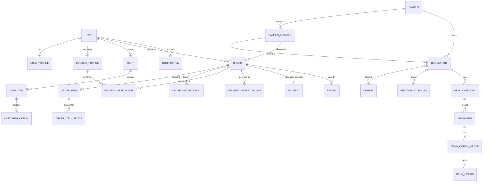

# CoogCrave — Database Design

> **Status:** Implemented in Phase 3 · **Last updated:** 2026-10-11
> PostgreSQL 16 · Drizzle ORM 0.45 (changed from Prisma in Phase 2; see `ARCHITECTURE.md` §16) · Every table below exists in the committed migrations (`db/migrations/0000_initial_schema.sql`, `0001_app_role_append_only.sql`). The Drizzle schema in `src/server/db/schema/` is the source of truth; this file explains it. Tables for later features (cart, orders, delivery, reviews) are created now so their constraints are tested from day one; the services that write them arrive in Phases 4–6.

---

## 1. Conventions

| Topic | Rule | Why |
|---|---|---|
| Primary keys | `uuid` with DB default `gen_random_uuid()` for **every** table, including the auth tables (Better Auth is configured with `generateId: "uuid"`) | Non-sequential IDs can't be enumerated by guessing `/orders/1235`; one ID type means every `user_id` foreign key is a real `uuid` FK |
| Money | **Integer cents** (`integer`), currency fixed to `USD` on orders | Floating point can't represent $0.10 exactly; rounding errors in totals are unacceptable. Like a cashier counting pennies in a drawer instead of estimating fractions of a dollar. |
| Rates | Basis points (`integer`, 825 = 8.25%) | Keeps rate math in integers; rounding rule is explicit (round half up, once, at the line it applies to) |
| Time | `timestamptz`; `created_at` defaults to `now()` in the DB; `updated_at` set server-side by Drizzle (`$onUpdate`) | Clients never supply timestamps |
| Names | `snake_case` tables/columns in SQL, `camelCase` properties in the Drizzle schema (`src/server/db/schema/`) | Idiomatic SQL, idiomatic TS |
| Soft delete | `deleted_at timestamptz NULL` on catalog data (restaurants, menu categories/items/options, campus locations) | Orders keep valid foreign keys to items that were "removed" from the menu |
| Not soft-deleted | Orders, events, payments, reviews, audit events are never deleted; users are **suspended**, not deleted | History and accountability |
| Constraints in the schema | Partial unique indexes (`uniqueIndex().on(...).where(...)`) and `CHECK` constraints (`check(...)`) are declared in the Drizzle schema, so they appear in generated migrations and drift checks like any other column (34 `CHECK`s today) | The DB enforces invariants even if application code has a bug |
| Text lengths | User-supplied text uses `varchar(n)` with the limits shown below; the API validates the same limits first so users see a friendly message | A second wall behind the API's validation |
| Same-restaurant rule | Rows that must stay inside one restaurant carry `restaurant_id` and use **composite foreign keys** `(x_id, restaurant_id)` → `parent (id, restaurant_id)` | The database itself refuses "a Burger Joint burger in a Panda Express cart" |
| Grants | The app connects as `coogcrave_app` (DML only, no DDL). Migrations run as the owner role | A SQL injection can't drop tables; append-only tables are enforced by grants (§4.12) |

---

## 2. Entity overview

---

## 3. Enumerations

| Enum | Values |
|---|---|
| `user_role` | `STUDENT`, `ADMIN` |
| `courier_status` | `PENDING`, `APPROVED`, `REJECTED`, `SUSPENDED` |
| `transport_mode` | `WALK`, `BIKE`, `SCOOTER` |
| `order_status` | `PLACED`, `CONFIRMED`, `READY_FOR_PICKUP`, `ASSIGNED`, `PICKED_UP`, `DELIVERED`, `CANCELLED`, `DELIVERY_FAILED` |
| `actor_type` | `CUSTOMER`, `COURIER`, `RESTAURANT_SIM`, `ADMIN`, `SYSTEM` |
| `assignment_end_reason` | `DELIVERED`, `RELEASED_BY_COURIER`, `UNASSIGNED_BY_ADMIN`, `ORDER_CANCELLED`, `DELIVERY_FAILED` |
| `payment_provider` | `DEMO` |
| `payment_status` | `AUTHORIZED`, `CAPTURED`, `VOIDED` |
| `notification_type` | `ORDER_PLACED`, `ORDER_CONFIRMED`, `ORDER_READY`, `COURIER_ASSIGNED`, `COURIER_RELEASED`, `ORDER_PICKED_UP`, `ORDER_DELIVERED`, `ORDER_CANCELLED`, `DELIVERY_FAILED`, `COURIER_APPLICATION_DECIDED` |

---

## 4. Tables

Abbreviations: **PK** primary key · **FK** foreign key · **U** unique · **NN** not null · **IDX** index.

### 4.1 Identity (Better Auth 1.7.7)

Better Auth reads and writes four tables through the Drizzle adapter (plural names: `usePlural: true`). We wrote them in our own schema file (`schema/auth.ts`) instead of using the library's generator, so they follow our conventions; the integration tests prove Better Auth works against them.

**`users`**

| Column | Type | Notes |
|---|---|---|
| `id` | uuid | PK |
| `name` | varchar(100) | NN (also checked in a sign-up hook: 1–100 characters after trimming, no control characters or `< >`) |
| `email` | varchar(254) | **U** NN; **`CHECK email = lower(email)`** so `Alex@uh.edu` and `alex@uh.edu` can't be two accounts |
| `email_verified` | boolean | NN default false |
| `image` | text | NULL (unused; required by Better Auth) |
| `role` | `user_role` | NN default `STUDENT`. Declared `input: false`: no request can set it. Only the seed and `pnpm admin:create` make admins |
| `suspended_at` | timestamptz | NULL. `input: false`. A suspended user can't start a session (checked in a session-create hook) and every request re-reads it |
| `created_at`, `updated_at` | timestamptz | |

**`sessions`** — `id`, `user_id` FK ON DELETE CASCADE, `token` **U**, `expires_at`, `ip_address`, `user_agent`, timestamps. Fixed 7-day lifetime (not extended by activity). IDX `(user_id)`.

**`accounts`** — `id`, `user_id` FK ON DELETE CASCADE, `account_id`, `provider_id` (`credential` for email/password), `password` (scrypt hash, via Better Auth; only the auth library and the account helpers in `src/server/accounts` write it, and nothing outside Better Auth reads it), OAuth token columns (unused, kept for the adapter), timestamps. U `(provider_id, account_id)`.

**`verifications`** — `id`, `identifier`, `value`, `expires_at`, timestamps. Holds password-reset tokens; with `storeIdentifier: "hashed"`, the identifier is stored as a hash, so a database leak doesn't reveal live reset tokens. (Email-verification links are signed JWTs and aren't stored here; see `THREAT_MODEL.md` T-17.) IDX `(identifier)`.

### 4.2 `campuses`
Configuration per campus. One row (UH main campus) in the MVP; exists so multi-campus is a data change, not a migration.

| Column | Type | Constraints / notes |
|---|---|---|
| `id` | uuid | PK |
| `slug` | text | U NN (`uh-main`) |
| `name` | text | NN |
| `timezone` | text | NN (`America/Chicago`) |
| `delivery_fee_cents` | integer | NN, `CHECK ≥ 0` (sample 249) |
| `service_fee_bps` | integer | NN, `CHECK 0–10000` |
| `service_fee_min_cents`, `service_fee_max_cents` | integer | NN, `CHECK min ≤ max` |
| `tax_rate_bps` | integer | NN — **sample rate, labeled in UI** |
| `min_subtotal_cents` | integer | NN (sample 500) |
| `max_tip_cents` | integer | NN (sample 5000) |
| `created_at`, `updated_at` | timestamptz | |

### 4.3 `user_profiles`
App-level profile kept separate from auth tables so changing auth providers never touches app data.

| Column | Type | Constraints / notes |
|---|---|---|
| `user_id` | uuid | PK, FK → `users.id` ON DELETE CASCADE |
| `display_name` | varchar(60) | NULL (API also refuses control characters and `< >`) |
| `default_location_id` | uuid | FK → `campus_locations.id`, NULL (the service only accepts active drop points) |
| `created_at`, `updated_at` | timestamptz | |

The row is created on the user's first profile save (upsert); `GET /me` treats a missing row as empty fields.

### 4.4 `courier_profiles`

| Column | Type | Constraints / notes |
|---|---|---|
| `id` | uuid | PK |
| `user_id` | uuid | **U** NN, FK → `users.id` |
| `status` | courier_status | NN default `PENDING` |
| `transport_mode` | transport_mode | NN |
| `guidelines_accepted_at` | timestamptz | NN |
| `is_online` | boolean | NN default false; **`CHECK (NOT is_online OR status = 'APPROVED')`** |
| `online_since` | timestamptz | NULL |
| `applied_at` | timestamptz | NN default now() |
| `reviewed_at` | timestamptz | NULL |
| `reviewed_by_user_id` | uuid | FK → `users.id`, NULL |
| `review_note` | text | NULL, ≤ 500 |
| `created_at`, `updated_at` | timestamptz | |

IDX: `(status)` for the admin approval queue; partial `(id) WHERE is_online` for online counts.

### 4.5 `campus_locations`
Implements "delivery locations." Buildings and landmarks on campus; used both as restaurant pickup sites and as customer drop points.

| Column | Type | Constraints / notes |
|---|---|---|
| `id` | uuid | PK |
| `campus_id` | uuid | FK NN |
| `name` | varchar(120) | NN (e.g., "MD Anderson Library") |
| `short_name` | varchar(40) | NN (shown on courier offers) |
| `description` | text | NULL (landmark hints) |
| `is_drop_point` | boolean | NN default true |
| `sort_order` | integer | NN default 0 |
| `created_at`, `updated_at`, `deleted_at` | timestamptz | |

U: `(campus_id, name) WHERE deleted_at IS NULL`. Restaurants' pickup buildings are rows with `is_drop_point = false` when they aren't also drop points.

### 4.6 Catalog

**`restaurants`**

| Column | Type | Constraints / notes |
|---|---|---|
| `id` | uuid | PK |
| `campus_id` | uuid | FK NN |
| `location_id` | uuid | FK → `campus_locations` NN (pickup building) |
| `slug` | text | U NN, `CHECK` lowercase-and-hyphens format |
| `name` | text | NN |
| `description` | text | NULL |
| `image_path` | text | NULL (local asset under `/public/images/sample/`) |
| `pickup_notes` | text | NULL |
| `is_accepting_orders` | boolean | NN default true (admin switch) |
| `is_sample_data` | boolean | NN default true (drives the "Sample" badge) |
| `created_at`, `updated_at`, `deleted_at` | timestamptz | |

IDX: `(campus_id) WHERE deleted_at IS NULL`; trigram index on `name` for search (`pg_trgm`) if search needs it — decided in Phase 4 after measuring.

**`cuisines`** — `id`, `slug` U, `name`. **`restaurant_cuisines`** — PK `(restaurant_id, cuisine_id)`.

**`restaurant_hours`**

| Column | Type | Constraints / notes |
|---|---|---|
| `id` | uuid | PK |
| `restaurant_id` | uuid | FK NN |
| `day_of_week` | smallint | `CHECK 0–6` (0 = Sunday, campus time zone) |
| `opens_at_minute` | smallint | `CHECK 0–1439` |
| `closes_at_minute` | smallint | `CHECK opens_at_minute < closes_at_minute ≤ 2880` (values > 1440 mean after midnight) |

U: `(restaurant_id, day_of_week, opens_at_minute)`. Multiple rows per day allow split shifts.

**`menu_categories`** — `id`, `restaurant_id` FK, `name`, `sort_order`, `deleted_at`. U `(id, restaurant_id)` (target of the composite FK below); U `(restaurant_id, name) WHERE deleted_at IS NULL`.

**`menu_items`**

| Column | Type | Constraints / notes |
|---|---|---|
| `id` | uuid | PK |
| `restaurant_id` | uuid | FK NN |
| `category_id` | uuid | NN; **composite FK `(category_id, restaurant_id)` → `menu_categories (id, restaurant_id)`** so an item can't be filed under another restaurant's category |
| `name` | text | NN, ≤ 80 |
| `description` | text | NULL, ≤ 300 |
| `price_cents` | integer | NN `CHECK ≥ 0` |
| `image_path` | text | NULL |
| `is_available` | boolean | NN default true |
| `sort_order` | integer | NN default 0 |
| `created_at`, `updated_at`, `deleted_at` | timestamptz | |

IDX: `(restaurant_id, category_id, sort_order) WHERE deleted_at IS NULL`.

**`menu_option_groups`** — `id`, `menu_item_id` FK, `name` (e.g., "Size"), `min_select` (`CHECK ≥ 0`), `max_select` (`CHECK ≥ 1 AND ≥ min_select`), `sort_order`, `deleted_at`.
A group with `min_select = 1, max_select = 1` is a required single choice; `0..3` is "up to three add-ons."

**`menu_options`** — `id`, `option_group_id` FK, `name`, `price_delta_cents` (`CHECK ≥ 0`), `is_available`, `sort_order`, `deleted_at`.

### 4.7 Cart (server-side)

**`carts`** — `id`, `user_id` **U** FK ON DELETE CASCADE, `restaurant_id` FK NN, `created_at`, `updated_at`. One cart per user, one restaurant per cart. U `(id, restaurant_id)` (target of the composite FK below).

**`cart_items`** — `id`, `cart_id`, `restaurant_id`, `menu_item_id`, `quantity` (`CHECK 1–20`), `special_instructions` varchar(140), `created_at`.
- Composite FK `(cart_id, restaurant_id)` → `carts (id, restaurant_id)` ON DELETE CASCADE
- Composite FK `(menu_item_id, restaurant_id)` → `menu_items (id, restaurant_id)`

Together they make "an item from a different restaurant than the cart" impossible at the database level.

**`cart_item_options`** — PK `(cart_item_id, menu_option_id)`, cascade on cart item delete.

Carts store **no prices**; every read computes current prices, so a menu change is reflected immediately and unavailable items are flagged.

### 4.8 Orders

**`orders`**

| Column | Type | Constraints / notes |
|---|---|---|
| `id` | uuid | PK |
| `order_number` | text | **U** NN — short human-friendly code (e.g., `CC-7K3Q9`), random, retried on collision; `CHECK` format `^CC-[0-9A-Z]{5,12}$` |
| `customer_id` | uuid | FK → `users.id` NN |
| `campus_id` | uuid | FK NN |
| `restaurant_id` | uuid | FK NN |
| `restaurant_name_snapshot` | text | NN |
| `delivery_location_id` | uuid | FK → `campus_locations` NN |
| `delivery_location_snapshot` | text | NN (building name at order time) |
| `delivery_instructions` | text | NULL, ≤ 280 — redacted per retention policy |
| `status` | order_status | NN default `PLACED` |
| `status_updated_at` | timestamptz | NN default now() |
| `subtotal_cents`, `delivery_fee_cents`, `service_fee_cents`, `tax_cents`, `tip_cents`, `total_cents` | integer | NN, each `CHECK ≥ 0`; **`CHECK total_cents = subtotal_cents + delivery_fee_cents + service_fee_cents + tax_cents + tip_cents`** |
| `currency` | char(3) | NN default `USD`, `CHECK = 'USD'` |
| `idempotency_key` | uuid | NN |
| `request_hash` | char(64) | NN (SHA-256 of canonical request body) |
| `version` | integer | NN default 0, `CHECK ≥ 0` (incremented on every transition) |
| `created_at`, `updated_at` | timestamptz | |

Constraints and indexes:
- **U `(customer_id, idempotency_key)`** — duplicate-submit protection.
- U `(id, restaurant_id)` — target of `order_items`' composite FK.
- IDX `(customer_id, created_at DESC)` — order history.
- IDX `(status_updated_at) WHERE status = 'READY_FOR_PICKUP'` — courier offers query.
- IDX `(status, created_at DESC)` — admin order list.
- IDX `(restaurant_id, created_at DESC)` — Kitchen Console.

**`order_items`** — snapshot of what was bought.

| Column | Type | Constraints / notes |
|---|---|---|
| `id` | uuid | PK |
| `order_id` | uuid | NN; composite FK `(order_id, restaurant_id)` → `orders (id, restaurant_id)` ON DELETE CASCADE |
| `restaurant_id` | uuid | NN |
| `menu_item_id` | uuid | NN; composite FK `(menu_item_id, restaurant_id)` → `menu_items (id, restaurant_id)` (soft-deleted items keep the reference valid) |
| `name_snapshot` | varchar(80) | NN |
| `unit_price_cents` | integer | NN `CHECK ≥ 0` |
| `options_total_cents` | integer | NN `CHECK ≥ 0` |
| `quantity` | integer | NN `CHECK 1–20` |
| `line_total_cents` | integer | NN; **`CHECK line_total_cents = (unit_price_cents + options_total_cents) * quantity`** |
| `special_instructions` | text | NULL, ≤ 140 |

**`order_item_options`** — `id`, `order_item_id` FK, `menu_option_id` FK, `group_name_snapshot`, `option_name_snapshot`, `price_delta_cents` (`CHECK ≥ 0`).

**`order_status_events`** — append-only history; the tracking timeline reads this. The app role has no `UPDATE`/`DELETE`/`TRUNCATE` on it (migration `0001`).

| Column | Type | Constraints / notes |
|---|---|---|
| `id` | uuid | PK |
| `order_id` | uuid | FK NN, ON DELETE CASCADE (see below) |
| `from_status` | order_status | NULL (null for the creation event) |
| `to_status` | order_status | NN |
| `actor_type` | actor_type | NN |
| `actor_user_id` | uuid | FK → `users.id`, NULL; **`CHECK`: required unless `actor_type` is `SYSTEM` or `RESTAURANT_SIM`** |
| `reason` | varchar(300) | NULL (required for cancellations/failures by the state machine) |
| `created_at` | timestamptz | NN default now() |

IDX `(order_id, created_at)`.

**Why child rows cascade when an order is deleted:** the app never deletes orders, except demo reset (Phase 6) clearing demo accounts' orders. Postgres runs `ON DELETE CASCADE` as the table owner, so that delete works even though the app role can't delete events directly. Like shredding a whole case file: you can't pull pages out one at a time, but the file goes as a unit. `payments`, `delivery_assignments`, `delivery_offer_declines`, `reviews`, and order `notifications` cascade the same way.

### 4.9 Delivery

**`delivery_assignments`**

| Column | Type | Constraints / notes |
|---|---|---|
| `id` | uuid | PK |
| `order_id` | uuid | FK NN |
| `courier_id` | uuid | FK → `courier_profiles.id` NN |
| `assigned_at` | timestamptz | NN default now() |
| `picked_up_at` | timestamptz | NULL |
| `ended_at` | timestamptz | NULL — **NULL means active** |
| `end_reason` | assignment_end_reason | NULL; `CHECK ((ended_at IS NULL) = (end_reason IS NULL))` |
| `payout_cents` | integer | NULL; `CHECK (payout_cents IS NULL OR (end_reason = 'DELIVERED' AND payout_cents ≥ 0))` — simulated |

**Concurrency invariants (declared in the Drizzle schema; generated SQL shown):**
- `CREATE UNIQUE INDEX delivery_assignments_one_active_per_order ON delivery_assignments (order_id) WHERE ended_at IS NULL;`
- `CREATE UNIQUE INDEX delivery_assignments_one_active_per_courier ON delivery_assignments (courier_id) WHERE ended_at IS NULL;`

History of releases/reassignments is preserved because ended rows stay. IDX `(courier_id, assigned_at DESC)` for courier history.

**`delivery_offer_declines`** — PK `(order_id, courier_id)`, `created_at`. Hides a declined offer from that courier; insert is idempotent (`ON CONFLICT DO NOTHING`).

### 4.10 Payments (simulated)

**`payments`**

| Column | Type | Constraints / notes |
|---|---|---|
| `id` | uuid | PK |
| `order_id` | uuid | **U** FK NN |
| `provider` | payment_provider | NN (`DEMO` only in MVP) |
| `status` | payment_status | NN |
| `amount_cents` | integer | NN `CHECK ≥ 0` |
| `provider_reference` | text | NN (e.g., `demo_pi_…`; a Stripe PaymentIntent ID later) |
| `created_at`, `updated_at` | timestamptz | |

### 4.11 Engagement

**`notifications`** — `id`, `user_id` FK NN, `type` notification_type NN, `order_id` FK NULL, `title` (≤ 80), `body` (≤ 200), `read_at` NULL, `created_at`.
IDX `(user_id, created_at DESC)`; partial IDX `(user_id) WHERE read_at IS NULL` for the unread badge.

**`reviews`** — `id`, `order_id` **U** FK NN, `customer_id` FK NN, `courier_id` FK → `courier_profiles` NN, `rating` smallint `CHECK 1–5`, `comment` (≤ 500) NULL, `created_at`.
The unique `order_id` makes duplicate reviews impossible even under double-submit.

### 4.12 Operations

**`audit_events`** — append-only: migration `0001_app_role_append_only.sql` revokes `UPDATE`, `DELETE`, and `TRUNCATE` from the app role, so even a bug or an injected query running as the app can't rewrite history. Tested in `tests/integration/schema-constraints.test.ts`.

| Column | Type | Notes |
|---|---|---|
| `id` | uuid | PK |
| `actor_type` | actor_type | NN; **`CHECK` in (`ADMIN`, `SYSTEM`)** |
| `actor_user_id` | uuid | FK → `users.id`, NULL; **`CHECK`: required when `actor_type = 'ADMIN'`**. `SYSTEM` rows (CLI, scheduled jobs) have no user and name their source in `metadata.via` |
| `action` | varchar(64) | NN; **`CHECK` dotted lowercase format** (`user.create_admin`, `courier.approve`, `demo.reset`) |
| `target_type` | varchar(40) | NN |
| `target_id` | text | NN |
| `metadata` | jsonb | NN default `{}` — changed fields (before/after), reason; never secrets |
| `request_id` | varchar(64) | NULL |
| `created_at` | timestamptz | NN default now() (microsecond precision; the API's pagination cursor uses it) |

IDX `(created_at DESC)`, `(target_type, target_id)`.

**`rate_limit_buckets`** — PK `(key, window_start)`, `count integer`, IDX `(window_start)`. `key` is `rule name + ":" + SHA-256 of the trimmed, lowercased subject` (first 32 hex characters), so raw IPs and emails are never stored. Written with one atomic `INSERT … ON CONFLICT DO UPDATE SET count = count + 1 RETURNING count`; about 1 in 100 writes also deletes expired windows.

---

## 5. How the key operations touch the schema

| Operation | Tables written in one transaction | Integrity guaranteed by |
|---|---|---|
| Place order | `orders`, `order_items`, `order_item_options`, `order_status_events`, `payments`, `notifications`; delete `cart_items` | Idempotency unique key; total `CHECK`; line-total `CHECK` |
| Courier accepts | `orders` (CAS on status), `delivery_assignments`, `order_status_events`, `notifications` | CAS `WHERE status = 'READY_FOR_PICKUP'`; two partial unique indexes |
| Any transition | `orders` (CAS + `version`), `order_status_events`, `notifications`, maybe `delivery_assignments`, `payments`, `audit_events` | CAS on expected from-status |
| Review | `reviews` | Unique `order_id`; service checks `DELIVERED` and ownership |
| Admin mutation | target table + `audit_events` | Append-only grants on `audit_events` |
| Create/promote admin (CLI, Phase 3) | `users`, `accounts`, `audit_events` | One transaction; the audit row is written or nothing is |

---

## 6. Migrations policy

- `drizzle-kit generate` writes SQL to `db/migrations`; every migration is committed and reviewed like code. CI runs `pnpm db:drift`, which fails if the schema has changes with no committed migration, and `pnpm db:migrate` against a fresh database.
- Deployed environments run `pnpm db:migrate` (`drizzle-kit migrate`, migrator role) as an explicit pipeline step, never at app startup.
- **Destructive changes follow expand → migrate data → contract** across separate migrations (e.g., add new column, backfill, switch reads, drop old column later). Each PR that alters or drops columns states its rollback plan in the PR template.
- drizzle-kit doesn't generate down-migrations; rollback means a new forward migration. Dropping and recreating a database is acceptable **only** in development/test (the integration harness refuses databases whose names don't end in `_test`).
- **Hand-written migrations** are allowed for things drizzle-kit can't express (grants). They're created with `drizzle-kit generate --custom` so the journal and snapshots stay consistent, and they explain themselves in a header comment. `0001_app_role_append_only.sql` is the first one; it requires the `coogcrave_app` role to exist and fails loudly otherwise.

---

## 7. Seed data

| Command | What it writes | Safe to re-run? |
|---|---|---|
| `pnpm db:seed` | The UH campus row (sample fees: $2.49 delivery, 5% service fee between $0.50 and $3.00, 8.25% sample tax, $5 minimum, $50 max tip), 14 real UH buildings as drop points (including the RAD Center), 10 cuisines, 11 sample restaurants **using real UH venue names** (5 in the RAD Center, 6 in Student Center South) with sample hours, 31 sample menu items (one marked unavailable), and option groups. Sample restaurants dropped from the data file are soft-deleted, and cuisines no one uses any more are removed; restaurants an admin added (`is_sample_data = false`) are never touched | Yes. IDs are derived from stable keys (`seedId("restaurant:the-burger-joint")`), rows are upserted, and each restaurant's hours are replaced, so a second run leaves the same data |
| `pnpm db:seed:demo` | Four demo accounts on the reserved `.test` domain: `customer@`, `courier@` (approved courier), `applicant@` (pending courier), `admin@` — all `@demo.coogcrave.test`, all email-verified | Yes. Resets their passwords to `SEED_DEMO_PASSWORD` (from `.env`, 10+ characters, never in source). **Refuses when `APP_ENV=production`** |
| `pnpm admin:create --email <e> --name <n>` | Creates a verified admin account, or promotes an existing one (which keeps its own password), and writes a `SYSTEM` audit event (`user.create_admin` / `user.promote_admin`, `metadata.via = "cli:admin:create"`) | Yes. The password comes from `ADMIN_PASSWORD` or a hidden prompt, never a command-line argument (which would land in shell history); a new account's password must pass the password policy |

- All seeded restaurants have `is_sample_data = true`. Their **names are real** UH venues (decision D2, `DEVELOPMENT_PLAN.md`; answers PRD Q1), but descriptions, menus, prices, options, and hours are invented sample data, and the UI must label every restaurant "Sample menu — not affiliated". No logos or brand marks. Venue names were checked against UH's listings on 2026-10-10; campus dining changes, so re-check before a demo.
- Demo emails use `.test`, a top-level domain reserved so it can never receive real mail.

---

## 8. Data retention (policy now, automation post-MVP)

| Data | Retention |
|---|---|
| `orders.delivery_instructions` | Set to NULL 30 days after the order reaches a terminal status |
| Courier access to customer details | Active assignment + 24 h after it ends (enforced in the service projection) |
| `audit_events` | 1 year |
| Sessions | Expire 7 days after sign-in (fixed, not extended by activity); deleted on sign-out and password reset. Suspension blocks them on the next request; deleting them on suspend arrives with the admin suspend endpoint (Phase 6) |
| Account deletion (on request) | User row anonymized; orders retained without personal data |
