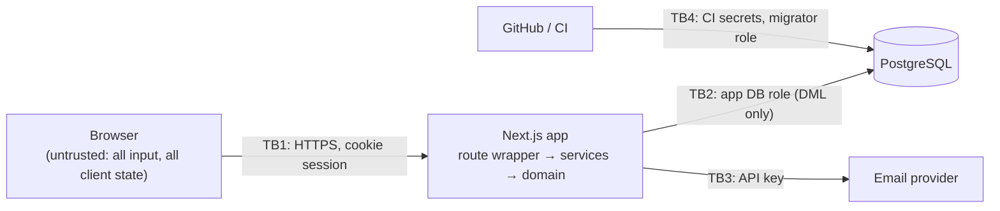

# CoogCrave — Threat Model

> **Status:** Approved at Phase 1; control status updated after Phase 2 (§5) · **Last updated:** 2026-10-10
> Method: assets → actors → trust boundaries → threats (STRIDE) with a mitigation **and a way to verify it**. A control without a verification is listed as unverified, not as done. Re-reviewed at the end of every phase (`CODE_REVIEW_LOG.md`).

---

## 1. Assets

| Asset | Why it matters |
|---|---|
| Accounts and sessions | Takeover lets an attacker order as, or deliver as, someone else |
| Personal data: name, email, drop point, delivery instructions | Students' location patterns on campus are sensitive |
| Order integrity: prices, totals, status | Wrong totals or forged statuses break trust (and would be fraud with real money) |
| Role/capability state: admin role, courier approval | Escalation unlocks every other asset |
| Audit trail | Accountability for admin actions |
| Secrets: auth secret, DB credentials, email API key | Full compromise if leaked |
| Brand/legal standing | Implying UH or restaurant endorsement is a reputational and trademark risk |

## 2. Actors

| Actor | Capability | Typical motive |
|---|---|---|
| Anonymous visitor / bot | Public pages, auth endpoints | Credential stuffing, scraping, spam sign-ups |
| Curious or malicious student (customer) | Valid account; can craft raw HTTP requests | See others' orders, change prices, act as courier/restaurant |
| Malicious courier | Approved courier account | See customer details without a job, claim deliveries not made, grab many offers |
| Compromised admin | Full admin UI | Data exfiltration, sabotage |
| Developer mistake | Repo / CI access | Committed secrets, debug endpoints left on, demo tooling in production |

## 3. Trust boundaries

Everything crossing **TB1** is validated and authorized on the server. The client's role, cart prices, totals, and status are never trusted.

---

## 4. Threats and mitigations

Verification types: **U** unit test · **I** integration test (real DB) · **E** E2E test · **L** lint/static rule · **C** CI check · **R** manual review checklist. "Phase" is when the control lands.

### Access control (highest risk for this app)

| ID | STRIDE | Threat | Mitigation | Verify | Phase |
|---|---|---|---|---|---|
| T-01 | Info disclosure | Customer reads another customer's order by changing the ID (IDOR) | Service-layer `canViewOrder` policy; viewer-specific projection; non-visible → `404`; non-sequential UUIDs | I: every order endpoint × {owner, other customer, unassigned courier, assigned courier, admin} | 3–4 |
| T-02 | Elevation | Sign-up or profile request includes `role: "ADMIN"` | Better Auth `input: false` on `role`/`suspendedAt`; strict Zod schemas reject unknown fields; no API grants admin | I: sign-up with `role` field → user is `STUDENT`; `PATCH /me` with `role` → `400` | 3 |
| T-03 | Elevation | Customer calls courier or admin endpoints directly | Route auth level + service policy re-check | I: role × endpoint matrix (401/403/404 as specified) | 3–6 |
| T-04 | Spoofing | Customer advances their own order to `CONFIRMED`/`READY_FOR_PICKUP` (impersonating the restaurant) | Transition table allows those moves only for `RESTAURANT_SIM`; `actingAs` accepted only from admins | U: exhaustive transition × actor table · I: customer attempts → `409`/`403` | 4–5 |
| T-05 | Info disclosure | Courier harvests customer names/instructions from offers | Offer projection excludes PII; full details only for the assigned courier, time-boxed to 24 h after the assignment ends | I: response-shape assertions on offers and on non-assigned courier `GET /orders/{id}` | 5 |
| T-06 | Elevation | Courier accepts their own order (self-dealing) | `customer_id <> courier user` in the CAS `WHERE`; policy check | I | 5 |
| T-07 | Elevation | Suspended user keeps acting via an existing session | Suspension deletes sessions; session cookie cache off/≤ 60 s; guards check `suspendedAt` | I | 6 |

### Integrity and business logic

| ID | STRIDE | Threat | Mitigation | Verify | Phase |
|---|---|---|---|---|---|
| T-08 | Tampering | Client sends modified prices, fees, or totals | Server-side cart and pricing; client total used only as a consistency check (`PRICE_CHANGED`); DB `CHECK` on total = sum of parts | U: pricing · I: tampered `expectedTotalCents` never changes the stored total | 4 |
| T-09 | Tampering | Two couriers accept the same order; one courier grabs two | CAS update on status + partial unique indexes (one active assignment per order, per courier) | I: N concurrent accepts → exactly one `200`, one active row | 5 |
| T-10 | Tampering | Double-submitted order creates duplicate charges/orders | Required `Idempotency-Key`; unique `(customer_id, idempotency_key)`; body-hash comparison | I: parallel identical submits → one order; different body same key → `422` | 4 |
| T-11 | Tampering | Out-of-order status changes (delivered before pickup), concurrent admin cancel vs courier pickup | Single `transitionOrder` path; CAS on expected from-status | U + I | 4–5 |
| T-12 | Repudiation | Admin denies performing a destructive action | Append-only `audit_events` (DB grants prevent UPDATE/DELETE by app role) | I: app role `UPDATE audit_events` fails | 3, 6 |
| T-13 | Tampering | Duplicate or foreign reviews | Unique `order_id`; policy: owner + `DELIVERED` only | I | 6 |

### Authentication and session

| ID | STRIDE | Threat | Mitigation | Verify | Phase |
|---|---|---|---|---|---|
| T-14 | Spoofing | Credential stuffing / brute force | Rate limits on sign-in (Postgres-backed, works across serverless instances); password ≥ 10 chars + common-password check | I: exceeding limit → `429` | 3 |
| T-15 | Info disclosure | Account enumeration via sign-up/reset messages | Generic responses and equal response shapes for existing/non-existing emails | I | 3 |
| T-16 | Spoofing | Session theft or fixation | httpOnly, `Secure` (deployed), `SameSite=Lax` cookies; session rotated on sign-in; server-side sessions revocable; 7-day expiry | I: cookie attributes · R | 3 |
| T-17 | Spoofing | Verification/reset token reuse or guessing | Library-generated single-use, expiring tokens; tokens never logged | I: reused token rejected | 3 |
| T-18 | Spoofing | Open redirect via post-login `callbackURL` | Only same-origin relative paths accepted | U | 3 |
| T-19 | Spoofing | Non-UH sign-ups / treating email domain as enrollment proof | Domain allowlist; UI says "verified UH email," never "verified student" | I + R (copy review) | 3 |

### Web vulnerabilities

| ID | STRIDE | Threat | Mitigation | Verify | Phase |
|---|---|---|---|---|---|
| T-20 | Tampering | CSRF on cookie-authenticated mutations | `SameSite=Lax`; `Origin` check on all mutations; JSON-only bodies (cross-site forms can't send `application/json` without a preflight) | I: mutation with foreign `Origin` → `403`; form-encoded → `415` | 2 |
| T-21 | Tampering / info disclosure | Stored XSS through delivery instructions, reviews, names, menu text | React output escaping; **lint ban on `dangerouslySetInnerHTML`**; length limits; Content-Security-Policy (`script-src 'self'` + nonces, `object-src 'none'`, `frame-ancestors 'none'`) | L + E: a `<script>` payload renders as text · I: CSP header present | 2, 7 |
| T-22 | Tampering | SQL injection | Drizzle query builder (parameterized); raw SQL only through the `sql` tagged template, which parameterizes interpolations; **lint ban on `sql.raw()`** | L + R | 2 |
| T-23 | Info disclosure | Over-exposed API responses (returning Prisma rows with hashes or emails) | Explicit DTO mappers per projection; never return ORM objects | I: response shape assertions · R | 3+ |
| T-24 | DoS | Oversized bodies, unbounded lists, request floods | 16 KB body limit; pagination caps (≤ 50); rate limits | I: `413`, `429` | 2–3 |
| T-25 | Info disclosure | Missing security headers / clickjacking | `X-Content-Type-Options: nosniff`, `Referrer-Policy: strict-origin-when-cross-origin`, `frame-ancestors 'none'`, HSTS in deployed envs, `Permissions-Policy` | I: header assertions | 2 |

### Secrets, data, and operations

| ID | STRIDE | Threat | Mitigation | Verify | Phase |
|---|---|---|---|---|---|
| T-26 | Info disclosure | Secrets committed to Git | `.env*` in `.gitignore` (except `.env.example`); config read only from env; GitHub secret scanning + push protection once the remote exists; CI fails if any `.env` file is tracked | C | 2 |
| T-27 | Info disclosure | PII/secrets in logs | pino redaction (`password`, tokens, cookies, `authorization`, `deliveryInstructions`); never log bodies | U: logger redaction test | 2 |
| T-28 | Elevation | App DB credentials used for DDL or audit tampering | Separate migrator/app roles; app role has DML only and INSERT/SELECT on `audit_events` | I (tests run as app role) | 3 |
| T-29 | Tampering | Demo reset or demo seed run against production | Requires `APP_ENV ≠ production` **and** `DEMO_RESET_ENABLED=true` **and** admin; endpoint returns `404` otherwise; seed script refuses in production; audited | I: with `APP_ENV=production` → `404` | 6 |
| T-30 | Elevation | Vulnerable dependency | Exact pins + lockfile; `pnpm audit --audit-level=high` fails CI (accepted exceptions listed with reason and review date in `pnpm-workspace.yaml`); Dependabot weekly updates; dependencies justified in `ARCHITECTURE.md` | C | 2 |
| T-31 | Info disclosure | Error responses leak stack traces or SQL | Central error mapper; `500` returns code + requestId only | I | 2 |
| T-32 | Reputation | UI implies UH or restaurant endorsement | Disclaimers (landing, footer, restaurant cards); no UH logos/marks; "Sample data" badges | R: copy checklist in PR template | 4, 7 |

---

## 5. Control status

Status moves from **Designed** → **Implemented** (code exists) → **Verified** (its listed test or check passes). Nothing is called Verified on the strength of a library being installed.

### After Phase 2

| ID | Status | Evidence |
|---|---|---|
| T-20 CSRF | **Verified** (route layer) | `tests/unit/with-route.test.ts`: foreign `Origin` → 403, cross-site `Sec-Fetch-Site` → 403, form-encoded body → 415. `SameSite` cookies arrive with sessions in Phase 3. |
| T-21 XSS / CSP | **Verified** (headers, lint) · E2E pending | Unit tests assert the policy; on a running build every `<script>` carried the request's nonce; lint bans `dangerouslySetInnerHTML` (planted violation caught). The browser-level "no CSP violations" E2E test runs in CI only: the build sandbox can't download Chromium. |
| T-22 SQL injection | **Implemented** (lint) | Planted `sql.raw()` caught by lint. Becomes Verified with Phase 3 query code review. |
| T-24 Oversized bodies | **Verified** (body limit) | 413 on declared and streamed oversize bodies. Pagination caps and rate limits arrive with list endpoints and Phase 3. |
| T-25 Security headers | **Verified** | Unit tests and `curl` against a production build: nosniff, referrer, framing, permissions, COOP; HSTS only when `APP_ENV` is preview/production; no `X-Powered-By`. |
| T-26 Committed secrets | **Implemented** | `.env*` git-ignored except the example; `pnpm check:tracked-env` in CI. GitHub secret scanning and push protection: enable once the remote exists. |
| T-27 Logs | **Verified** | Redaction test covers passwords, tokens, cookies, auth headers, emails, delivery instructions; request bodies never logged. |
| T-28 DB privileges | **Verified** (schema-level) | Integration tests as the app role: can't create, alter, drop, or truncate. Append-only `audit_events` grant arrives with the table in Phase 3. |
| T-30 Dependencies | **Implemented** | Audit in CI. Production dependencies: 0 known vulnerabilities. Dev-only: 1 high accepted with written reason (braces via Next's lint plugin, no patched release), 1 moderate (esbuild dev server via drizzle-kit, never run). |
| T-31 Error leakage | **Verified** | 500s return code + request ID only; health check hides DB error text. |
| All others | Designed | Land in the phase listed in §4. |

### OWASP checklist from the master prompt

| Prompt checklist item | Threat IDs | Status after Phase 2 |
|---|---|---|
| Broken access control | T-01 – T-07, T-12 | Designed (Phase 3+) |
| Injection | T-22 | Implemented (lint guard) |
| Cross-site scripting | T-21 | Verified at header/lint level; E2E in CI |
| CSRF | T-20 | Verified at route level |
| Insecure session management | T-14 – T-18 | Designed (Phase 3) |
| Exposed credentials | T-26, T-28 | Implemented / verified (schema-level grants) |
| Sensitive data leakage | T-05, T-23, T-27, T-31 | T-27, T-31 verified; T-05, T-23 Phase 3+ |
| Missing server-side validation | T-02, T-08, route wrapper (strict Zod) | Route-level validation verified; business rules Phase 3+ |
| Unsafe dependency usage | T-30 | Implemented |
| Insecure API endpoints | T-03, T-24, T-25, T-29 | T-24 (body limit), T-25 verified; others Phase 3+ |

---

## 6. Residual and accepted risks (MVP)

| Risk | Why accepted now | Planned control |
|---|---|---|
| A courier marks "delivered" without delivering | No real money moves; customer rating + admin review exist | Post-MVP: 4-digit delivery code shown to the customer, entered by the courier |
| Compromised admin account | Small admin set; full audit trail | Post-MVP: mandatory 2FA for admins (Better Auth two-factor plugin), shorter admin sessions |
| Email domain ≠ enrollment | Explicitly not claimed in UI | Future: university SSO if partnership exists |
| Polling reveals status changes only every ~5 s | Not a security issue; UX tradeoff | SSE later |
| Hosting/email provider not yet chosen | Credentials not available | Phase 8 decision; until then local-only |
