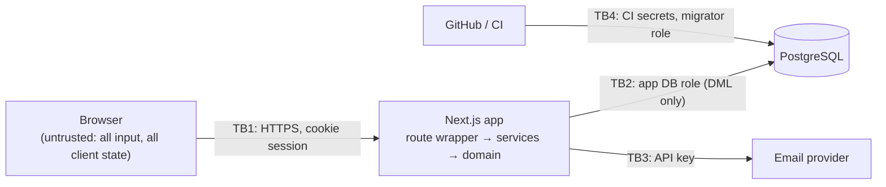

# CoogCrave — Threat Model

> **Status:** Approved at Phase 1; control status updated after Phase 6a (§5) · **Last updated:** 2026-10-11
> Method: assets → actors → trust boundaries → threats (STRIDE) with a mitigation **and a way to verify it**. A control without a verification is listed as unverified, not as done. Re-reviewed at the end of every phase (`CODE_REVIEW_LOG.md`).

---

## 1. Assets

| Asset | Why it matters |
|---|---|
| Accounts and sessions | Takeover lets an attacker order as, or deliver as, someone else |
| Personal data: name, email, drop point, delivery instructions | Students' location patterns on campus are sensitive |
| Order integrity: prices, totals, status | Wrong totals or forged statuses break trust (and would be fraud with real money) |
| Role/capability state: admin role, courier approval | Escalation unlocks every other asset |
| Audit trail | Accountability for admin actions |
| Secrets: auth secret, DB credentials, email API key | Full compromise if leaked |
| Brand/legal standing | Implying UH or restaurant endorsement is a reputational and trademark risk |

## 2. Actors

| Actor | Capability | Typical motive |
|---|---|---|
| Anonymous visitor / bot | Public pages, auth endpoints | Credential stuffing, scraping, spam sign-ups |
| Curious or malicious student (customer) | Valid account; can craft raw HTTP requests | See others' orders, change prices, act as courier/restaurant |
| Malicious courier | Approved courier account | See customer details without a job, claim deliveries not made, grab many offers |
| Compromised admin | Full admin UI | Data exfiltration, sabotage |
| Developer mistake | Repo / CI access | Committed secrets, debug endpoints left on, demo tooling in production |

## 3. Trust boundaries

Everything crossing **TB1** is validated and authorized on the server. The client's role, cart prices, totals, and status are never trusted.

---

## 4. Threats and mitigations

Verification types: **U** unit test · **I** integration test (real DB) · **E** E2E test · **L** lint/static rule · **C** CI check · **R** manual review checklist. "Phase" is when the control lands.

### Access control (highest risk for this app)

| ID | STRIDE | Threat | Mitigation | Verify | Phase |
|---|---|---|---|---|---|
| T-01 | Info disclosure | Customer reads another customer's order by changing the ID (IDOR) | Service-layer `canViewOrder` policy; viewer-specific projection; non-visible → `404`; non-sequential UUIDs | I: every order endpoint × {owner, other customer, unassigned courier, assigned courier, admin} | 3–4 |
| T-02 | Elevation | Sign-up or profile request includes `role: "ADMIN"` | Better Auth `input: false` on `role`/`suspendedAt`; strict Zod schemas reject unknown fields; no API grants admin | I: sign-up with `role` field → user is `STUDENT`; `PATCH /me` with `role` → `400` | 3 |
| T-03 | Elevation | Customer calls courier or admin endpoints directly | Route auth level + service policy re-check | I: role × endpoint matrix (401/403/404 as specified) | 3–6 |
| T-04 | Spoofing | Customer advances their own order to `CONFIRMED`/`READY_FOR_PICKUP` (impersonating the restaurant) | Transition table allows those moves only for `RESTAURANT_SIM`; `actingAs` accepted only from admins | U: exhaustive transition × actor table · I: customer attempts → `409`/`403` | 4–5 |
| T-05 | Info disclosure | Courier harvests customer names/instructions from offers | Offer projection excludes PII; full details only for the assigned courier, time-boxed to 24 h after the assignment ends | I: response-shape assertions on offers and on non-assigned courier `GET /orders/{id}` | 5 |
| T-06 | Elevation | Courier accepts their own order (self-dealing) | Pure `acceptRefusal` policy checked inside the accept transaction (`CANNOT_ACCEPT_OWN_ORDER`); own orders never appear as offers or can be declined | I | 5 |
| T-07 | Elevation | Suspended user keeps acting via an existing session | Every request re-reads `suspended_at` (session cookie cache off); sign-in refused for suspended accounts (session-create hook); suspension also deletes sessions (admin endpoint, Phase 6) | I: suspended identity with a valid cookie denied on every endpoint | 3, 6 |

### Integrity and business logic

| ID | STRIDE | Threat | Mitigation | Verify | Phase |
|---|---|---|---|---|---|
| T-08 | Tampering | Client sends modified prices, fees, or totals | Server-side cart and pricing; client total used only as a consistency check (`PRICE_CHANGED`); DB `CHECK` on total = sum of parts | U: pricing · I: tampered `expectedTotalCents` never changes the stored total | 4 |
| T-09 | Tampering | Two couriers accept the same order; one courier grabs two | CAS update on status + partial unique indexes (one active assignment per order, per courier) | I: N concurrent accepts → exactly one `200`, one active row | 5 |
| T-10 | Tampering | Double-submitted order creates duplicate charges/orders | Required `Idempotency-Key`; unique `(customer_id, idempotency_key)`; body-hash comparison | I: parallel identical submits → one order; different body same key → `422` | 4 |
| T-11 | Tampering | Out-of-order status changes (delivered before pickup), concurrent admin cancel vs courier pickup | Single `transitionOrder` path; CAS on expected from-status | U + I | 4–5 |
| T-12 | Repudiation | Admin denies performing a destructive action | Append-only `audit_events` (DB grants prevent UPDATE/DELETE by app role) | I: app role `UPDATE audit_events` fails | 3, 6 |
| T-13 | Tampering | Duplicate or foreign reviews | Unique `order_id`; policy: owner + `DELIVERED` only | I | 6 |

### Authentication and session

| ID | STRIDE | Threat | Mitigation | Verify | Phase |
|---|---|---|---|---|---|
| T-14 | Spoofing | Credential stuffing / brute force | Rate limits on sign-in per IP **and per email** (Postgres-backed, shared across instances); password 10–128 chars, zxcvbn strength score ≥ 3 (catches common and dictionary passwords), and not built from the user's own name or email. Per-IP limits trust the first `X-Forwarded-For` entry, which is safe only behind a proxy that overwrites it (Vercel does; confirm at deployment). Per-email limits don't depend on it | I: exceeding limit → `429` from any IP · U: password policy | 3 |
| T-15 | Info disclosure | Account enumeration via sign-up/reset messages | Generic responses and equal response shapes for existing/non-existing emails | I | 3 |
| T-16 | Spoofing | Session theft or fixation | httpOnly, `Secure` (whenever served over https), `SameSite=Lax` cookies; a new random session is created at sign-in (there is no pre-sign-in session to fix); server-side sessions, deleted on sign-out and password reset; fixed 7-day expiry | I: cookie attributes, server-side sign-out, forged cookie rejected · R | 3 |
| T-17 | Spoofing | Verification/reset token reuse or guessing | **Reset:** random token, stored hashed (`storeIdentifier: "hashed"`), single-use, 1-hour expiry, revokes all sessions when used. **Verification:** signed JWT, 24-hour expiry; reusable within that window, which is harmless because it can only re-confirm the same address and never signs anyone in. Tokens are kept out of logs (reset tokens in paths are replaced with `:token`) | I: reused reset token rejected; made-up token rejected; verify link gives no session | 3 |
| T-18 | Spoofing | Open redirect via post-login `callbackURL` | Better Auth's origin check (pinned on even in tests) refuses off-site `callbackURL`/`redirectTo`; our `safeNextPath` accepts only same-site relative paths for `?next=` | U: `safeNextPath` · I: off-site verify/reset redirects → `403` | 3 |
| T-19 | Spoofing | Non-UH sign-ups / treating email domain as enrollment proof | Domain allowlist; UI says "verified UH email," never "verified student" | I + R (copy review) | 3 |

### Web vulnerabilities

| ID | STRIDE | Threat | Mitigation | Verify | Phase |
|---|---|---|---|---|---|
| T-20 | Tampering | CSRF on cookie-authenticated mutations, including **login CSRF** (signing a victim into the attacker's account) | `SameSite=Lax`; `Origin` check on all mutations, including sign-in and sign-up; JSON-only bodies (cross-site forms can't send `application/json` without a preflight) | I: mutation with foreign `Origin` → `403`; form-encoded → `415` | 2–3 |
| T-21 | Tampering / info disclosure | Stored XSS through delivery instructions, reviews, names, menu text | React output escaping; **lint ban on `dangerouslySetInnerHTML`**; length limits; Content-Security-Policy (`script-src 'self'` + nonces, `object-src 'none'`, `frame-ancestors 'none'`) | L + E: a `<script>` payload renders as text · I: CSP header present | 2, 7 |
| T-22 | Tampering | SQL injection | Drizzle query builder (parameterized); raw SQL only through the `sql` tagged template, which parameterizes interpolations; **lint ban on `sql.raw()`** | L + R | 2 |
| T-23 | Info disclosure | Over-exposed API responses (returning Prisma rows with hashes or emails) | Explicit DTO mappers per projection; never return ORM objects | I: response shape assertions · R | 3+ |
| T-24 | DoS | Oversized bodies, unbounded lists, request floods | 16 KB body limit; pagination caps (≤ 50); rate limits | I: `413`, `429` | 2–3 |
| T-25 | Info disclosure | Missing security headers / clickjacking | `X-Content-Type-Options: nosniff`, `Referrer-Policy: strict-origin-when-cross-origin`, `frame-ancestors 'none'`, HSTS in deployed envs, `Permissions-Policy` | I: header assertions | 2 |

### Secrets, data, and operations

| ID | STRIDE | Threat | Mitigation | Verify | Phase |
|---|---|---|---|---|---|
| T-26 | Info disclosure | Secrets committed to Git | `.env*` in `.gitignore` (except `.env.example`); config read only from env; GitHub secret scanning + push protection once the remote exists; CI fails if any `.env` file is tracked | C | 2 |
| T-27 | Info disclosure | PII/secrets in logs | pino redaction (`password`, tokens, cookies, `authorization`, `deliveryInstructions`); never log bodies | U: logger redaction test | 2 |
| T-28 | Elevation | App DB credentials used for DDL or audit tampering | Separate migrator/app roles; app role has DML only and INSERT/SELECT on `audit_events` | I (tests run as app role) | 3 |
| T-29 | Tampering | Demo reset or demo seed run against production | Requires `APP_ENV ≠ production` **and** `DEMO_RESET_ENABLED=true` **and** admin; endpoint returns `404` otherwise; seed script refuses in production; audited | I: with `APP_ENV=production` → `404` | 6 |
| T-30 | Elevation | Vulnerable dependency | Exact pins + lockfile; `pnpm audit --audit-level=high` fails CI (accepted exceptions listed with reason and review date in `pnpm-workspace.yaml`); Dependabot weekly updates; dependencies justified in `ARCHITECTURE.md` | C | 2 |
| T-31 | Info disclosure | Error responses leak stack traces or SQL | Central error mapper; `500` returns code + requestId only | I | 2 |
| T-32 | Reputation | UI implies UH or restaurant endorsement | Disclaimers (landing, footer, restaurant cards); no UH or restaurant logos/marks; real venue names (D2) always shown with "Sample menu — not affiliated"; generic menu item names; "Sample data" badges | R: copy checklist in PR template | 3, 4, 7 |
| T-33 | DoS / annoyance | Email flooding: repeated sign-up, reset, or resend requests for someone else's address fill their inbox (sign-up to an existing address sends the owner a notice) | Per-email limits on all four email-sending endpoints (3–5 per hour), regardless of source IP | I: per-email caps hold across IPs | 3 |
| T-34 | Spoofing | A mail scanner (or anyone who sees the link) "clicks" the verification link and gets a session | `autoSignInAfterVerification: false`; the user signs in with their password afterwards | I: verify response sets no session cookie | 3 |
| T-35 | Elevation | A demo account with a known password exists in production | Demo seed refuses `APP_ENV=production`; demo emails use the reserved `.test` domain; the password comes only from `SEED_DEMO_PASSWORD`. Admins in production are created only with `pnpm admin:create`, which is audited | I | 3 |

---

## 5. Control status

Status moves from **Designed** → **Implemented** (code exists) → **Verified** (its listed test or check passes). Nothing is called Verified on the strength of a library being installed.

### After Phase 6a

| ID | Status | Evidence |
|---|---|---|
| T-03 Route-level access | **Verified** for all admin endpoints | Role matrix extended to the 7 new admin endpoints: anonymous 401, students and couriers 403, admin allowed. Admin pages answer 404 to non-admins (E2E). |
| T-07 Suspended sessions | **Verified, complete** | Suspending deletes every session; E2E: the suspended student is bounced to sign-in and signing in again is refused. Courier suspension takes them offline; a suspension racing an accept never lets both succeed (15 rounds, both orders seen). |
| T-12 Audit | **Verified** for every 6a admin action | `courier.<decision>`, `user.suspend/unsuspend` (with reason), `order.admin_<status>` (with reason), `demo.reset` rows naming the admin; shown in the activity log with links. |
| T-29 Demo reset | **Verified** | Off by default; config refuses `DEMO_RESET_ENABLED=true` in production (unit); service refuses in production or when off (integration); route answers 404 before reading the body; exact phrase required; touches only demo accounts' data; refuses while a demo courier holds an outside delivery (mutation-checked). |
| Admin self-protection | **Verified** | Admins can't suspend themselves or other admins, or decide on their own courier profile (422). |

### After Phase 5

| ID | Status | Evidence |
|---|---|---|
| T-01 IDOR | **Verified** for customers and couriers | Couriers who only saw an order as an offer, other couriers, and the courier 24 h after the delivery ended all get 404 (`delivery.test.ts`). |
| T-04 Impersonating the restaurant | **Verified** | Non-admins sending `actingAs` → 403; admins acting as the restaurant can only make restaurant moves (e.g. `DELIVERED` → 409); every kitchen action audited with the admin's name. |
| T-05 Courier data harvesting | **Verified** | Offer responses have exactly 8 fields and no name, note, email, or prices (asserted); the assigned courier sees "Alex R." (or a chosen display name) and the note only while active; mutation: removing the note gating fails the test. E2E checks the offer row shows neither name nor note. |
| T-06 Self-dealing | **Verified** | Own orders aren't offered, can't be declined (404), and accepting → 422 `CANNOT_ACCEPT_OWN_ORDER`. |
| T-09 Double accept | **Verified** | 6 couriers race for one order, 20 rounds per run, 20 consecutive runs (2 400 accepts): always exactly one `200` and one active assignment. A courier double-tapping two offers: always one success and `COURIER_HAS_ACTIVE_DELIVERY`. Mutation: with both compare-and-set guards removed, the partial unique index still keeps one winner (defense in depth works); removing its error translation too turns losers into 500s, which the test catches. |
| T-12 Audit | **Verified** for kitchen actions | `order.kitchen_confirmed` / `…_ready_for_pickup` / `…_cancelled` rows with the admin as actor. |

### After Phase 4

| ID | Status | Evidence |
|---|---|---|
| T-01 IDOR on orders | **Verified** for customers | `checkout-and-orders.test.ts`: another student gets 404 for the order, its transitions, and sees an empty list; malformed IDs 404; responses carry no customer ID, email, idempotency key, request hash, or payment reference. E2E: an admin opening a student's order page gets a real 404. Mutation: dropping the ownership filter fails the test. Courier/admin projections: Phases 5–6. |
| T-04 Customer impersonating the restaurant | **Verified** | Customer `CONFIRMED`/`READY_FOR_PICKUP`/`DELIVERED`/`PLACED` → 409; `actingAs` → 400 (not accepted until Phase 6); exhaustive state-machine unit tests. |
| T-08 Price tampering | **Verified** | Strict schemas reject client prices (`priceCents`, `totalCents`) with 400; a wrong `expectedTotalCents` → 409 `PRICE_CHANGED` with a fresh quote and no order (mutation-checked); totals re-derived from the menu on every cart read; DB `CHECK`s on totals and line totals. |
| T-10 Duplicate orders | **Verified** | Missing/invalid key → 400; same key + body → original order (200, `Idempotent-Replayed`); same key + different body → 422; 5 simultaneous identical requests → exactly one order and one payment (mutation: removing the in-lock replay fails it). E2E double-click places one order. |
| T-11 Conflicting transitions | **Verified** | Deterministic race test: a held row lock makes a customer cancel and a restaurant confirm both read `PLACED`; exactly one wins and the other gets `STALE_STATE`. Removing compare-and-set fails it every run. `expectedVersion` → `STALE_STATE`. |
| T-21 XSS via notes | **Verified** (input side) | Item notes and delivery instructions refuse `<`, `>`, and control characters; React escapes all output; no `dangerouslySetInnerHTML` (lint). |
| T-24 Abuse | **Verified** | Order list `limit` ≤ 50, cart ≤ 25 lines, quantity ≤ 20, per-user limits on cart, quote, order, and transition endpoints (429 observed in tests before counters were reset between tests). |
| T-32 Implied endorsement | **Verified** (labels) · copy review pending | Every restaurant row and page says "Sample menu, not affiliated"; the list intro and footer explain; no logos or images. |

### After Phase 3

| ID | Status | Evidence |
|---|---|---|
| T-02 Role injection | **Verified** | `auth-security.test.ts`: sign-up with `role: "ADMIN"` → `STUDENT`; `suspendedAt`/`emailVerified` refused. `role-access.test.ts`: `PATCH /me` with `role` → `400`. |
| T-03 Route-level access | **Verified** for every Phase 3 endpoint | `role-access.test.ts`: 5 endpoints × 6 identities (anonymous, student, approved courier, admin, suspended, unverified) with the documented status and code for each cell; forged cookie rejected. Page guards unit-tested; E2E shows `/admin` → 404 for students. New endpoints join the matrix as they're added. |
| T-07 Suspended sessions | **Verified** (request-time check) · deletion Phase 6 | Suspended identity with a still-valid cookie is denied everywhere; suspended sign-in refused. |
| T-12 Audit tampering | **Verified** | `schema-constraints.test.ts` as the app role: `UPDATE`/`DELETE`/`TRUNCATE` on `audit_events` and `order_status_events` fail; `INSERT`/`SELECT` work. |
| T-14 Brute force | **Verified** | `rate-limiter.test.ts`: atomic under 40 concurrent requests; `auth-security.test.ts`: per-email sign-in limit holds across rotating IPs; password policy unit tests (short, common, personal, `Spring2027!`). |
| T-15 Enumeration | **Verified** | Sign-up for an existing email returns the same status and body as a new one; unknown email and wrong password give identical `401` bodies; reset requests answer identically. Timing differences aren't measured (see §6). |
| T-16 Sessions | **Verified** | Cookie is `HttpOnly`, `SameSite=Lax`, `Path=/`, `Max-Age=604800`; sign-out deletes the row; forged cookie → `401`. `Secure` is set by Better Auth when `APP_URL` is https, which tests (http) can't exercise; confirm on the first deployment. |
| T-17 Tokens | **Verified** | Reset token works once, then `INVALID_TOKEN`; made-up token rejected; other sessions revoked; reset path logged as `/reset-password/:token`. |
| T-18 Open redirect | **Verified** | Off-site verify/reset redirects → `403` (with origin checks pinned on under `NODE_ENV=test`, a bug this caught); `safeNextPath` unit tests. |
| T-19 Domain allowlist | **Verified** (code) · copy review pending | `uh.edu` and its subdomains accepted; look-alikes (`evil-uh.edu`, `uh.edu.attacker.example`, `uhedu.com`) refused. UI copy says "UH email", never "verified student"; human copy review pending. |
| T-20 CSRF | **Verified** (route layer and `/api/auth`) | Foreign `Origin`/cross-site requests to `/api/auth` → `403`; form posts → `415`. |
| T-22 SQL injection | **Verified** (lint + review) | All Phase 3 queries use the query builder or the `sql` template; no `sql.raw()` (one seed use was caught and removed in self-review). |
| T-23 Over-exposure | **Verified** for Phase 3 responses | `GET /me` and audit responses built by explicit mappers; tests assert no password hash, session token, or unexpected keys. |
| T-24 DoS | **Verified** | `413` on `/api/auth` and `/api/v1`; audit list capped at 50; `429` with `Retry-After`. |
| T-27 Logs | **Verified** | Better Auth's own messages pass through the logger with emails replaced by `[email]` (integration test). |
| T-28 DB privileges | **Verified** | All integration tests run as the app role; append-only grants tested (T-12). |
| T-33 Email flooding | **Verified** | Per-email caps on sign-up notices and reset emails hold across IPs. Found during self-review (Phase 3 log, #9). |
| T-34 Scanner sign-in | **Verified** | Verification sets no session cookie. |
| T-35 Demo accounts in production | **Verified** | Seed refuses `APP_ENV=production`; admin CLI audited. |

### After Phase 2

| ID | Status | Evidence |
|---|---|---|
| T-20 CSRF | **Verified** (route layer) | `tests/unit/with-route.test.ts`: foreign `Origin` → 403, cross-site `Sec-Fetch-Site` → 403, form-encoded body → 415. `SameSite` cookies arrive with sessions in Phase 3. |
| T-21 XSS / CSP | **Verified** (headers, lint) · E2E pending | Unit tests assert the policy; on a running build every `<script>` carried the request's nonce; lint bans `dangerouslySetInnerHTML` (planted violation caught). The browser-level "no CSP violations" E2E test runs in CI only: the build sandbox can't download Chromium. |
| T-22 SQL injection | **Implemented** (lint) | Planted `sql.raw()` caught by lint. Becomes Verified with Phase 3 query code review. |
| T-24 Oversized bodies | **Verified** (body limit) | 413 on declared and streamed oversize bodies. Pagination caps and rate limits arrive with list endpoints and Phase 3. |
| T-25 Security headers | **Verified** | Unit tests and `curl` against a production build: nosniff, referrer, framing, permissions, COOP; HSTS only when `APP_ENV` is preview/production; no `X-Powered-By`. |
| T-26 Committed secrets | **Implemented** | `.env*` git-ignored except the example; `pnpm check:tracked-env` in CI. GitHub secret scanning and push protection: enable once the remote exists. |
| T-27 Logs | **Verified** | Redaction test covers passwords, tokens, cookies, auth headers, emails, delivery instructions; request bodies never logged. |
| T-28 DB privileges | **Verified** (schema-level) | Integration tests as the app role: can't create, alter, drop, or truncate. Append-only `audit_events` grant arrives with the table in Phase 3. |
| T-30 Dependencies | **Implemented** | Audit in CI. Production dependencies: 0 known vulnerabilities. Dev-only: 1 high accepted with written reason (braces via Next's lint plugin, no patched release), 1 moderate (esbuild dev server via drizzle-kit, never run). |
| T-31 Error leakage | **Verified** | 500s return code + request ID only; health check hides DB error text. |
| All others | Designed | Land in the phase listed in §4. |

### OWASP checklist from the master prompt

| Prompt checklist item | Threat IDs | Status after Phase 6a |
|---|---|---|
| Broken access control | T-01 – T-07, T-12 | T-01 – T-07 and T-12 verified (customers, couriers, admins) |
| Injection | T-22 | Verified (lint + review of Phase 3 queries) |
| Cross-site scripting | T-21 | Verified at header/lint level; new forms render user text only through React |
| CSRF | T-20 | Verified, including login CSRF |
| Insecure session management | T-14 – T-18, T-34 | Verified; `Secure` cookie flag to confirm on first https deployment |
| Exposed credentials | T-26, T-28, T-35 | Verified (grants, demo-seed guard); no secrets in source (`.env.example` holds local-only values) |
| Sensitive data leakage | T-05, T-23, T-27, T-31 | T-23 (Phase 3 responses), T-27, T-31 verified; T-05 Phase 5 |
| Missing server-side validation | T-02, T-08, route wrapper (strict Zod) | Verified for Phase 3 inputs; DB `CHECK`s back up order math ahead of Phase 4 |
| Unsafe dependency usage | T-30 | Implemented (audit in CI) |
| Insecure API endpoints | T-03, T-24, T-25, T-29, T-33 | Verified (T-03 extended to admin endpoints in 6a) |

---

## 6. Residual and accepted risks (MVP)

| Risk | Why accepted now | Planned control |
|---|---|---|
| A courier marks "delivered" without delivering | No real money moves; customer rating + admin review exist | Post-MVP: 4-digit delivery code shown to the customer, entered by the courier |
| Compromised admin account | Small admin set; full audit trail | Post-MVP: mandatory 2FA for admins (Better Auth two-factor plugin), shorter admin sessions |
| Email domain ≠ enrollment | Explicitly not claimed in UI | Future: university SSO if partnership exists |
| Polling reveals status changes only every ~5 s | Not a security issue; UX tradeoff | SSE later |
| Hosting/email provider not yet chosen | Credentials not available | Phase 8 decision; until then local-only. Mail goes to a local outbox folder; deployed environments refuse that transport at startup |
| Response-time differences could reveal whether an email has an account | Bodies and statuses are identical and per-email limits slow probing. Sign-in already hashes a dummy password for unknown emails (Better Auth), but sign-up and reset requests do different work for existing and new addresses | Measure in Phase 7; even out the slow paths if the difference is measurable |
| Per-IP limits can be dodged by spoofing `X-Forwarded-For` if the app is ever exposed without a proxy | Per-email limits still hold; the intended host (Vercel) overwrites the header | Confirm proxy behavior in Phase 8 |
| Admin suspend/unsuspend has no endpoint yet | Suspension is enforced everywhere; only the admin button is missing | Phase 6 (PRD AUTH-7, ADM-3) |
